<h1 align="center">X6100 custom firmware</h1>

<p align="center"><b>A complete, fully featured SD-card firmware for the Xiegu X6100:
digital modes, DX cluster on the waterfall, Bluetooth, wfview server and a web configurator.</b></p>

<p align="center">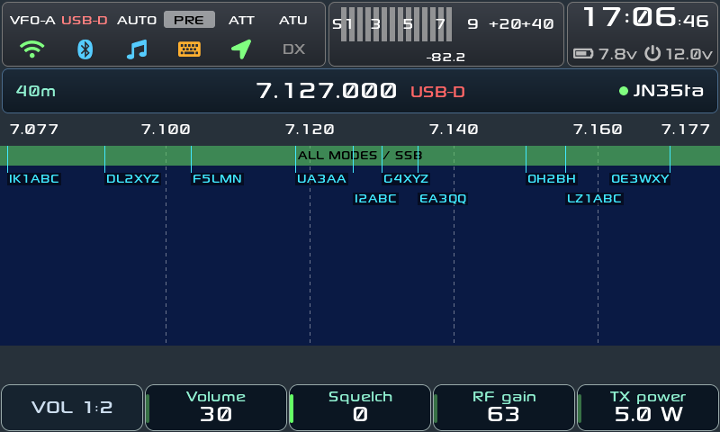</p>

<p align="center"><i>Main screen: S-meter, frequency strip, DX cluster tags and spot lines over the waterfall.
All screenshots in this README are rendered on a PC with fake data.</i></p>

Unofficial combined firmware for the Xiegu X6100. It starts from the R1CBU
GUI (0.34.2, maintained by gdyuldin), adds the SWL and digital-mode apps of
the 1KO125 fork and the JS8 app of randal007, and on top of that a DX
Cluster shown on the main screen, Bluetooth CAT and headphones, WiFi and
Bluetooth settings on the radio, a wfview (Icom LAN) server and a web
configurator. It is a complete SD card image: everything else on the radio
works as in the base firmware.

> **Baseband compatibility.** Some options depend on the radio's baseband
> revision (TX audio, band output gain, TX filter, CESSB, FM emphasis). A
> patched r12 baseband is recommended. The baseband version is shown in
> Settings → Info.

## Contents

- [Features](#features)
- [Screenshots](#screenshots)
- [Install](#install)
- [Usage](#usage)
- [Web configurator](#web-configurator)
- [wfview server](#wfview-server)
- [Reference](#reference)
- [Build](#build)
- [Credits](#credits)
- [License](#license)

## Features

**Operating**

- Band, VFO and mode strip with GPS locator (or saved QTH) always visible
- Channel list and MEM 1-9 slots, editable from the web configurator
- Long-press action on every button group: screenshot, recorder, mute, apps, QTH grid
- SWR Scan, GPS view, Recorder and a CW decoder with WPM
- Local time zone (Settings → Date / Time → Zone); logs stay in UTC
- Fully editable band list and digital-mode frequencies

**Digital modes and apps** (APP → **Modes**)

- FT8 and FT4 with logging in ADIF (`ft_log.adi`) and worked-before marks
- JS8 (all four speeds at once): decoder, inbox, store and forward, log, APRS gateways
- RTTY, SSTV, WeFax and NavTex (from the 1KO125 fork), with broadcast frequency lists
- DX Cluster app: telnet client over WiFi, spots by frequency around the VFO, one-press tune, saved servers

**Display**

- Three themes: IU1WXY (default), Legacy and **Outdoor** (high contrast, black with white borders, sunlight waterfall palette)
- DX cluster on the main screen: callsign tags and spot lines on the waterfall, plus a cluster column at the right (rotate the MFK to browse, long press to tune)
- S-meter with thin bars, S-scale and dB value; bars above S9 fade from green to red
- Waterfall mode **Centered** (VFO in the middle) or **Fixed** (span stays put, amber VFO line moves)
- Three fonts (Sony Sketch, Roboto, DejaVu), settings in cards, spectrum on/off

**Connectivity and remote**

- **wfview server**: Icom LAN protocol (UDP 50001-50003) with CI-V, RX audio and waterfall, appears as an IC-705
- **Bluetooth CAT**: Icom CI-V shared between USB and up to 3 Bluetooth clients
- **Bluetooth headphones**: RX audio over A2DP with volume and speaker mute
- WiFi scan/connect and Bluetooth pairing on the radio, WiFi sets the clock

**Web configurator** (port 80, HTTPS on 443)

- Bands, digital modes, DX cluster servers, wfview login, memories and channels, files and time from any browser

**System**

- Buildroot SD card image, settings and logs on a DATA partition (`/mnt`)
- ADIF import (`incoming_log.adi`) for worked-before marks
- Boot logo IU1WXY, info screen with firmware and baseband version

## Screenshots

<table>
  <tr>
    <td align="center">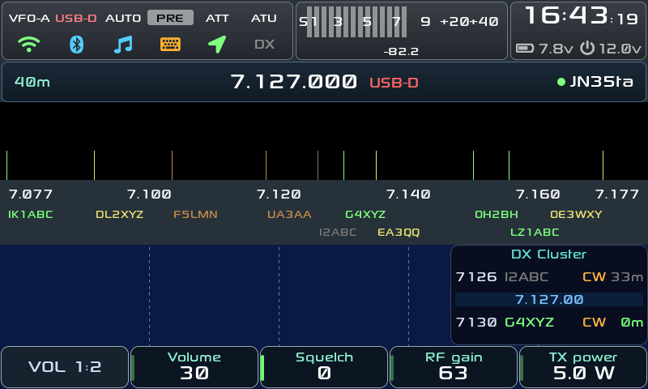<br><sub><b>Cluster column</b> at the right of the waterfall</sub></td>
    <td align="center">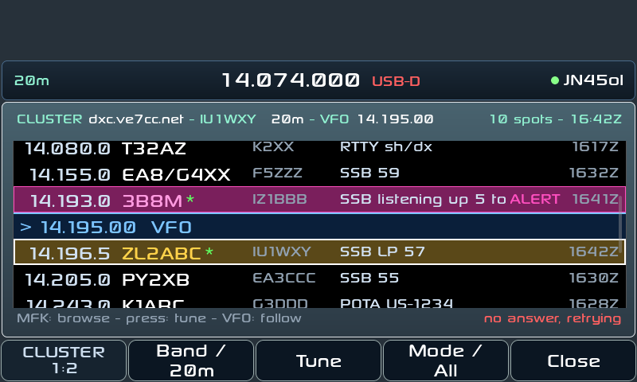<br><sub><b>DX Cluster app</b>: spots around the VFO, new spots marked</sub></td>
  </tr>
  <tr>
    <td align="center">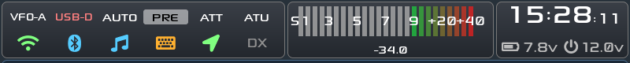<br><sub><b>S-meter</b> with the green-to-red gradient above S9</sub></td>
    <td align="center">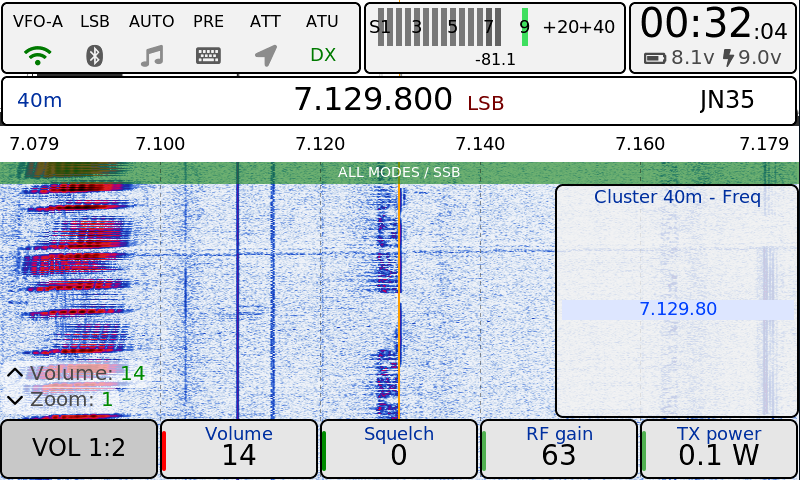<br><sub><b>Outdoor theme</b> for direct sunlight</sub></td>
  </tr>
  <tr>
    <td align="center">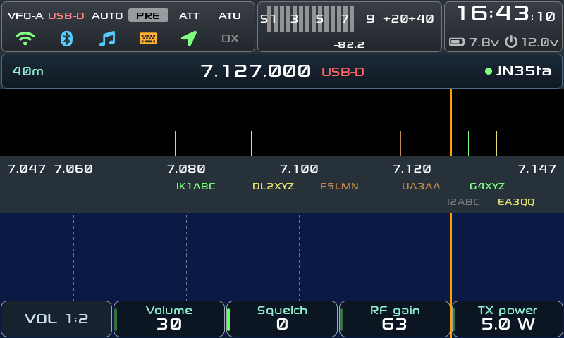<br><sub><b>Fixed waterfall</b> with the amber VFO line</sub></td>
    <td align="center">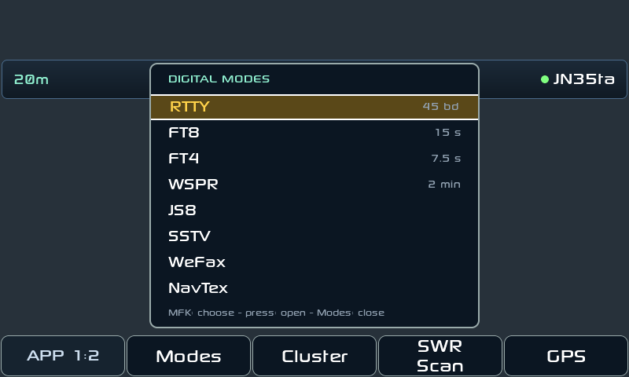<br><sub><b>Modes menu</b> on the APP buttons</sub></td>
  </tr>
  <tr>
    <td align="center">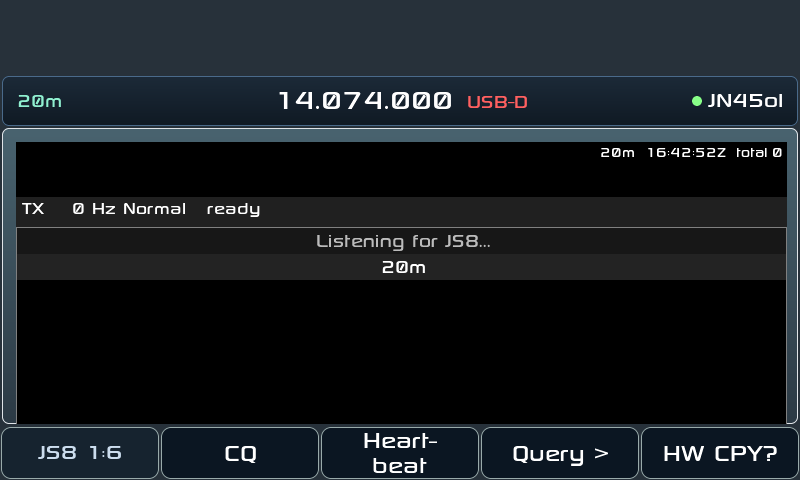<br><sub><b>JS8</b> app</sub></td>
    <td align="center">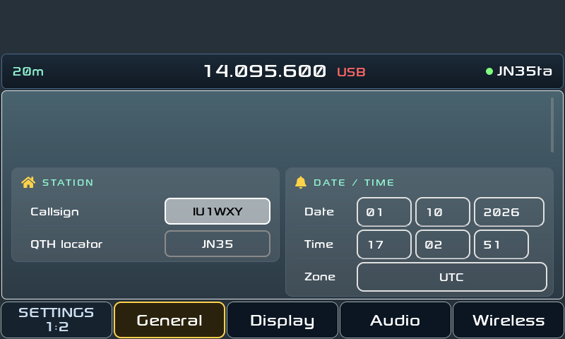<br><sub><b>Settings</b>: station, date/time and time zone</sub></td>
  </tr>
  <tr>
    <td align="center">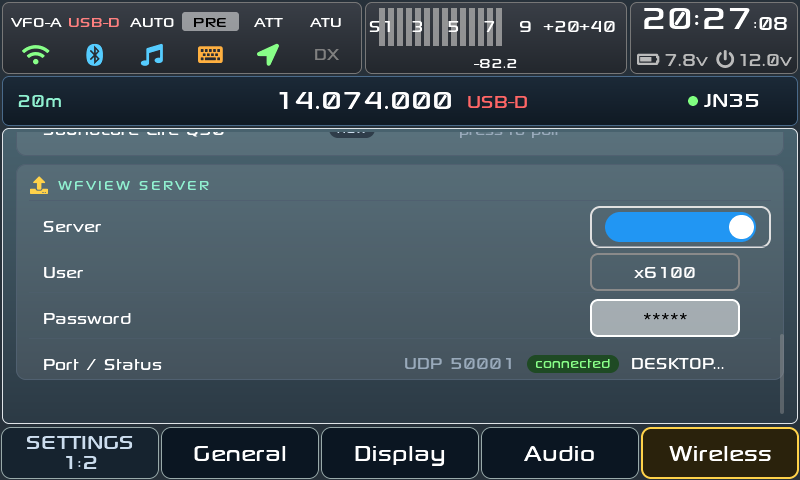<br><sub><b>wfview server</b> settings on the radio</sub></td>
    <td align="center">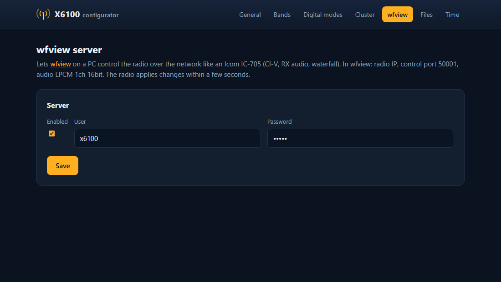<br><sub><b>wfview</b> page of the web configurator</sub></td>
  </tr>
  <tr>
    <td colspan="2" align="center">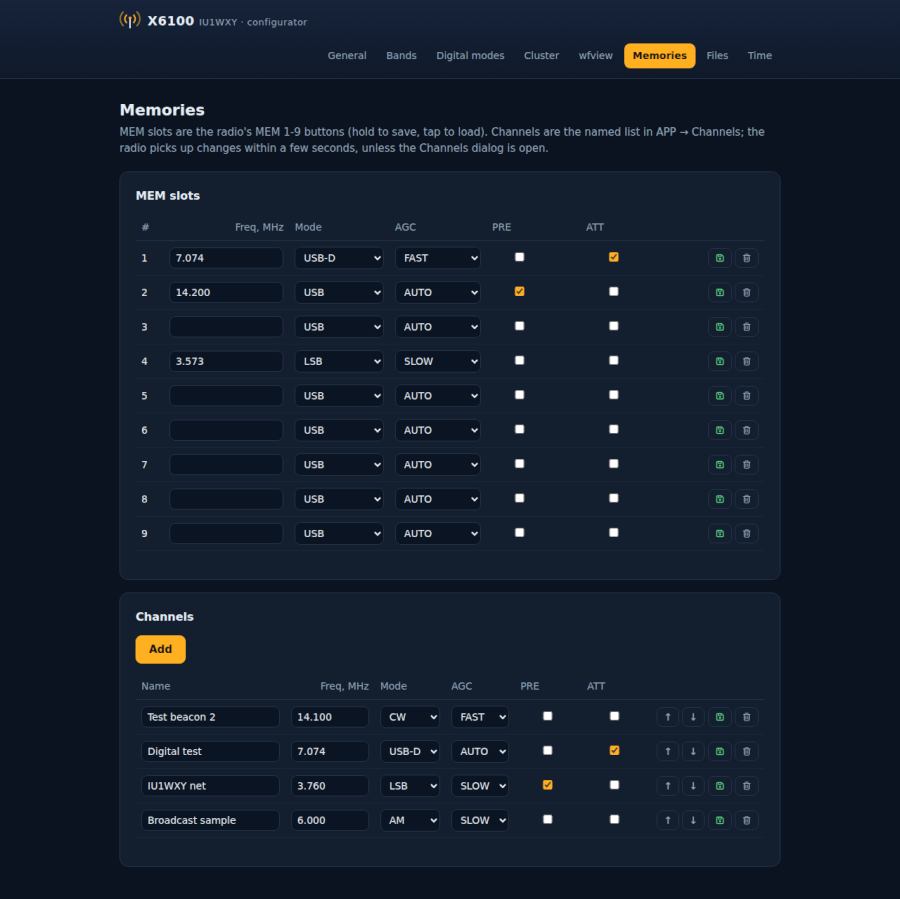<br><sub><b>Memories</b> page of the web configurator: MEM slots and channels</sub></td>
  </tr>
</table>

## Install

1. Get the SD card image `sdcard.<version>.img.zip`: from the repository's
   **Releases** page, or from the **Actions** page (run *Build image*, the
   image is an artifact of the run).
2. Write it to a microSD card with [balenaEtcher](https://etcher.balena.io/)
   or Rufus.
3. Put the card in the radio and switch on. The first start creates the
   **DATA** partition (mounted on `/mnt`), where your settings, logs and
   configuration files live.

Settings persist on `/mnt`. Writing a new image replaces the whole card,
DATA included: copy the DATA files to your PC first (at least `params.db`,
`qso_log.db`, the `.adi` logs, `cluster.conf`, `btcat.conf`, `btaudio.conf`,
`wfview.conf`, `js8_*.txt`) and copy them back after the first start.

To import an ADIF log for the worked-before marks, copy it to the DATA
partition as `incoming_log.adi`; it is imported at the next start.

## Usage

### Digital modes

APP (page 1) → **Modes** opens a menu: RTTY, FT8, FT4, JS8, SSTV, WeFax,
NavTex. Turn the **MFK** to choose, press to open; the last used mode is
marked. Pressing **Modes** again closes the menu.

APP buttons:

| Page | Buttons |
|---|---|
| 1 | Modes, Cluster, SWR Scan, GPS |
| 2 | Recorder, Settings |

Your callsign and QTH locator are set in Settings → General → **STATION**.
Callsign is needed by JS8, FT8 and the DX Cluster.

**Long press:** each button group (GEN, APP, KEY, MSG, DFN, DFL) has a
long-press action, chosen in Settings → General → **CONTROLS**: none,
screenshot, recorder on/off, mute, an app (RTTY, FT8, JS8, SSTV, Cluster,
WeFax, NavTex, SWR Scan, GPS, Settings, Recorder) or the QTH grid.

Each app has its own button pages, named like `(JS8 1:6)`; press the first
button to go to the next page.

### JS8

Beta 3 of randal007's [X6100 JS8](https://github.com/randal007/x6100-js8):
a JS8Call-compatible decoder and keyboard in the radio, with all four speeds
(Normal, Fast, Turbo, Slow) decoded at once.


First steps:

1. Set callsign and QTH in Settings → General → STATION. JS8 will not send
   without a callsign.
2. The radio clock must be within about 2 s: WiFi sets it, or use **Time
   Sync** (page 3) after some stations have decoded. It shifts only JS8's own
   timing (a drift shown on the top line); hold the button to reset it.
3. APP → **Modes** → **JS8**. The radio tunes the nearest JS8 frequency;
   the band keys step through JS8Call's (or GhostNet's) frequencies, or type
   your own (**Freq**, page 6). While JS8 is open the RX filter is
   200-3000 Hz, noise reduction, noise blanker and notch are off, and power
   is capped at 5 W; all go back when you leave.
4. Turn the **MFK** onto a station's row, then **HW CPY?** (page 1),
   **Reply** (page 2) or **Query >** (page 1).
5. **ESC** or the top knob stops sending; the next ESC leaves the app.

Nothing sends by itself: AUTO (automatic replies), HB (heartbeats) and HB ACK
are off every time the app opens.

Buttons (the first one of each row turns the page, hold to go back):

| Page | Buttons |
|---|---|
| 1 | CQ (hold: auto CQ), Heartbeat, Query >, HW CPY? |
| 2 | Show: No HB / Directed / All, Reply, Send..., Clear |
| 3 | Time Sync, Hold: Off / On, Show Stations / Messages, Inbox |
| 4 | AUTO, HB, HB ACK, Settings... (INFO, STATUS, Relay, Groups) |
| 5 | APRS >, Log QSO, Activ.: Off / POTA / SOTA, Log prompt |
| 6 | Alerts >, Speed, Decode: All speeds / My speed, Freq: JS8 / GhostNet / kHz |

What it does:

- One-press messages (SNR?, GRID?, INFO?, STATUS?, HEARING?, AGN?, RR, 73),
  an **Inbox** for `MSG` messages, relays and store-and-forward like desktop
  JS8Call.
- **Log:** the Log popup (page 5, or when a QSO ends with 73/SK) saves to
  `js8call_log.adi` in desktop JS8Call's ADIF format, with POTA/SOTA
  activation fields. FT8 keeps its own `ft_log.adi`.
- **Alerts:** beeps for messages, CQs and new stations, and purple alert
  words.
- **APRS** through JS8 gateways: grid and GPS position beacons (optionally
  with a message), POTA and SOTA spots, SMS, email and Winlink.
- Rows in the list: blue sent by you, red to you, green a CQ, dark blue to a
  group, purple an alert word.

Known limits: relays, store and forward, and most APRS items are not yet
proven on the air (only the grid spot and SMS are). The main screen's
waterfall stands still while JS8 is open.

Design notes: [docs/RESEARCH.md](docs/RESEARCH.md),
[docs/TX_PLAN.md](docs/TX_PLAN.md), [docs/T6_PLAN.md](docs/T6_PLAN.md),
[docs/SPOTS_PLAN.md](docs/SPOTS_PLAN.md).

### DX Cluster


Needs WiFi (Settings → Wireless) and your callsign (Settings → General →
STATION), used to log in. The client connects in the background as soon as
both are there, and reconnects by itself (with a backoff) after an error or
when WiFi comes back. Spots older than 60 minutes are dropped. After login it
asks for the latest 50 spots (`sh/dx`).

**Cluster app** (APP → Cluster; pages `(CLUSTER 1:2)` and `(CLUSTER 2:2)`):

- The spots of the **current band**, sorted by frequency, with a VFO marker
  row among them. The list stays centred on the VFO: tuning scrolls it and
  selects the nearest spot. Spots within 3 kHz of the VFO are highlighted; a
  green `*` marks spots less than 2 minutes old.
- **MFK** turns browse the list (this stops the VFO following). An MFK press,
  the **Tune** button or a tap on a row tunes to the spot. The mode comes from
  the comment (CW, FT8, SSB, ...) or else from the band plan: CW, USB-D on
  the FT8/FT4 frequencies, LSB below 10 MHz, USB above.
- Page 1: **Band / All** switches between the current band and all bands
  (always all when the VFO is outside the amateur bands), **Tune**, **Close**.
- Page 2: **Server** opens the list of saved servers: MFK to choose, press (or
  tap) to use it, **Server** again or ESC to close. The choice is saved in
  `/mnt/cluster.conf`.
- The status line shows WiFi/cluster state ("Set your callsign", "WiFi not
  connected", "Connecting...", "cluster connected", or the error and
  "retrying").

**Main screen** (Settings → Display → SPECTRUM):

- **Cluster spots**: callsign tags in two staggered rows under the frequency
  labels and a marker line at each spot frequency on the waterfall.
- **Cluster column**: a box at the right of the waterfall with the spots of
  the band (kHz, callsign, age) around the VFO marker row.

Both are coloured by age: green under 2 minutes, yellow under 10, amber
under 30, grey older. Both use the same client as the app.

**Servers:** if `/mnt/cluster.conf` has no `server=` lines the app lists ten
public clusters (VE7CC, W3LPL, K1TTT, NC7J, W1NR, WA9PIE, K4ZR, DB0SUE,
GB7DJK, AE5E). The default is `dxc.ve7cc.net` port 23. Add and remove servers
from the [web configurator](#web-configurator) or in the file
([format](#files-on-mnt)).

### Bluetooth headphones

Radio RX audio to A2DP headphones. Pairing and connection are in Settings →
Wireless → BLUETOOTH; the audio switches are in Settings → Audio → **BT
HEADPHONES**.

1. Settings → Wireless: switch **Bluetooth** on, put the headphones in
   pairing mode and press **Scan headphones** (15 s).
2. MFK press on a device marked *new* pairs, trusts and connects it. On a
   paired device the menu offers Connect / Disconnect, **Connect at
   startup** and Remove.
3. Settings → Audio → BT HEADPHONES, with the headphones connected:
   - **RX to headphones**: a PulseAudio loopback from the radio RX audio
     (`alsa_input.platform-sound.stereo-fallback`) to the headphones.
   - **Headphone volume**: the headphones sink volume.
   - **Mute speaker**: AF volume 0 while the headphones are connected, back
     to the previous value when they disconnect. The AF volume does not change
     the audio sent to the headphones.

Only A2DP is used: HFP/HSP (SCO) gives no audio on this radio and drops the
WiFi, so PulseAudio has no headset backend
(`rootfs/etc/pulse/system.pa.d/btaudio.pa`). The same file stops PulseAudio
from looping a phone or tablet that connects for CAT (it also appears as an
A2DP source) into the radio TX audio.

Pairings are kept in a backup on `/mnt` and restored at boot
(`S39btpairings`), so a new image does not forget them.

### Bluetooth CAT

`btcat` (`btcat/btcat.c`) opens the real CAT UART (`/dev/ttyS2`) and
bind-mounts a pty over it, so the GUI talks to btcat. USB CAT and up to 3
Bluetooth clients share the CAT port: one request at a time, replies go back
to whoever asked, transceive frames (dst `0x00`) go to everyone.

Settings → Wireless → BLUETOOTH:

- **Bluetooth**: adapter power.
- **Discoverable (CAT)**: always visible, or only already paired devices can
  connect.

Pair with Just Works (no PIN). On Linux: `rfcomm connect /dev/rfcomm0
<BT-MAC> 1`, then use `/dev/rfcomm0`. On Windows and Android the paired
device exposes an outgoing COM/SPP port. Log files: `/tmp/btcat.log`,
`/tmp/btcat-setup.log`.

### Web configurator

A small web server (vendored in [webserver/](webserver/), Python/bottle) runs
on the radio on port 80: open `http://<radio IP>/` from any browser on the
same network. Pages:

| Page | Does |
|---|---|
| General | index of the pages below |
| Bands | edit the band list |
| Digital modes | add, edit and delete digital mode frequencies |
| Cluster | DX cluster servers: add, use, delete (writes `/mnt/cluster.conf`) |
| wfview | enable the wfview server, set user and password |
| Memories | MEM 1-9 slots and the named channel list |
| Gallery | screen recordings, voice recordings and screenshots; convert AVI to MP4 in the browser or on the radio (ffmpeg) |
| Files | browse `/mnt` |
| Time | local and server time, NTP sync, timezone |

The server also listens on HTTPS, port 443, with a self-signed certificate made
on first start (valid 10 years, stored in `/mnt/https/`). The browser shows a
certificate warning once; accept it. In-browser MP4 conversion in the Gallery
only works on the HTTPS page (WebCodecs needs a secure context); "Convert on
radio" works on both.

The radio picks up changes within a few seconds. Server options: `--host`,
`--port`, `--https-port` (0 = off), `--cert-dir`, `--db`, `--cluster-conf`, `--filebrowser-path`; see
[webserver/README.md](webserver/README.md).

| Cluster | Digital modes |
|---|---|
|  |  |

### wfview server

The radio can act as an Icom IC-705 on the network, so
[wfview](https://wfview.org) on a PC controls it with CI-V, RX audio and the
waterfall.

- **Off by default.** Enable it in Settings → Wireless (wfview card) or on
  the web configurator's **wfview** page. Default login `x6100` / `x6100`:
  change it in the same places (stored in `/mnt/wfview.conf`).
- Ports: UDP **50001** (control), **50002** (CI-V), **50003** (audio).
- In wfview add a network radio (IC-705 profile): radio IP, control port
  50001, the user and password above, audio codec **LPCM 1ch 16bit**.
- The Wireless card shows the connected client name.

### Settings

APP (page 2) → **Settings**. Tabs on two button pages: General, Display,
Audio, Wireless, and Info (page 2: app and base versions).

| Tab | Cards |
|---|---|
| General | STATION (callsign, QTH locator), DATE / TIME, CONTROLS (long-press actions, hand mic, frequency acceleration, charger), TX CALIBRATION, TRANSVERTERS |
| Display | BACKLIGHT, SPECTRUM (spectrum on/off, cluster spots, cluster column, auto level, min/max, fill, peaks), WATERFALL, INTERFACE (magnification, knob info, theme, font) |
| Audio | RX AUDIO, TX AUDIO, MICROPHONE, VOX, AGC, BT HEADPHONES |
| Wireless | WIFI (scan, connect, IP), BLUETOOTH (power, Discoverable (CAT), device list, Scan headphones) |
| Info | app and base firmware versions |

Some options say *(restart)*: Spectrum on/off and Font apply at the next
start. Some cards depend on the base firmware revision (TX AUDIO, band output
gain, TX filter, CESSB, FM emphasis).

## Reference

### Bluetooth CAT: connection

| | |
|---|---|
| Transport | Bluetooth SPP, RFCOMM channel 1 (or USB CAT) |
| SPP UUID | `00001101-0000-1000-8000-00805F9B34FB` |
| Pairing | Just Works, no PIN; device name `X6100` (`BTCAT_ALIAS` in `/etc/default/btcat`) |
| Protocol | Icom CI-V, radio address `0xA4` |
| Frame | `FE FE A4 <ctrl> <cmd> [sub] [data] FD`; reply `FB` = OK, `FA` = NG |
| Baud (USB) | 19200 8N1 (ignored over BT) |
| Hamlib / flrig / wfview | rig model Xiegu X6100 |

### Supported CI-V commands

| Cmd | Sub | Function | Read | Write |
|---|---|---|:-:|:-:|
| `00` | - | Frequency (transceive, sent automatically on every change) | - | yes |
| `03` | - | Read frequency | yes | - |
| `04` | - | Read mode | yes | - |
| `05` | - | Set frequency (5 BCD bytes) | - | yes |
| `06` | - | Set mode (`00` LSB, `01` USB, `02` AM, `03` CW, `05` NFM, `07` CW-R) | - | yes |
| `07` | - / `00` / `01` / `A0` / `B0` | VFO: read current, VFO A, VFO B, A=B, swap A/B | yes | yes |
| `0F` | - | Split off/on | yes | yes |
| `10` | - | Tuning step (`00` 10 Hz, `01` 100 Hz, `02` 500 Hz, `03` 1 kHz, `04` 5 kHz) | yes | yes |
| `11` | - | Attenuator | yes | yes |
| `14` | `01` | AF volume (0-255) | yes | yes |
| `14` | `02` | RF gain (0-255) | yes | yes |
| `14` | `03` | Squelch (0-255) | yes | yes |
| `14` | `0A` | TX power (0-255 = 0-10 W) | yes | yes |
| `14` | `15` | Monitor level | yes | - |
| `15` | `02` | S-meter | yes | - |
| `15` | `11` | TX power meter | yes | - |
| `15` | `12` | SWR meter | yes | - |
| `15` | `13` | ALC meter | yes | - |
| `16` | `02` | Preamp | yes | yes |
| `16` | `22` | Noise blanker | yes | yes |
| `16` | `40` | Noise reduction | yes | yes |
| `16` | `44` / `46` | Compressor / VOX (always off, write ignored) | yes | - |
| `19` | `00` | Transceiver ID (returns `A4`) | yes | - |
| `1A` | `03` | IF filter width | yes | - |
| `1A` | `06` | Mode + data mode (DIG) + filter group | yes | yes |
| `1C` | `00` | PTT (`00` RX, `01` TX) | yes | yes |
| `25` | `00` / `01` | Frequency of selected / unselected VFO | yes | yes |
| `26` | `00` / `01` | Mode + data mode of selected / unselected VFO | yes | yes |
| `27` | `10` `11` `14` `15` `19` | Scope status (stub replies for wfview compatibility, no waterfall data) | yes | - |

Anything else returns `FA` (NG).

Example, read frequency: `FE FE A4 E0 03 FD` →
`FE FE E0 A4 03 00 50 07 14 00 FD` (14.075.000 Hz).

### btcat-ctl

| Command | Effect |
|---|---|
| `btcat-ctl bt on\|off` | Bluetooth adapter power (= Settings → Wireless → Bluetooth) |
| `btcat-ctl discoverable on\|off` | Always visible / only paired devices (= Discoverable (CAT)) |
| `btcat-ctl status` | Print current settings |
| `btcat-ctl apply` | Re-apply settings from `/mnt/btcat.conf` |
| `/etc/init.d/S94btcat start\|stop\|restart` | Start/stop the bridge (set `BTCAT_ENABLE=no` in `/etc/default/btcat` to disable) |

### btaudio-ctl

Used by Settings → Wireless and Audio.

| Command | Effect |
|---|---|
| `btaudio-ctl list` | Paired devices and audio state (tab separated) |
| `btaudio-ctl scan` | 15 s scan, prints the new headphones found |
| `btaudio-ctl pair MAC` | Pair, trust and connect |
| `btaudio-ctl connect\|disconnect\|remove MAC` | Manage a device |
| `btaudio-ctl autoconnect MAC on\|off` | Connect at startup |
| `btaudio-ctl rx on\|off` | RX audio to the headphones (loopback) |
| `btaudio-ctl volume N` | Headphone volume, 0-100 % |
| `btaudio-ctl mute on\|off` | AF volume 0 while headphones are connected |
| `btaudio-ctl boot` / `monitor` | Started by `btcat-setup`: keeps the headphones on A2DP with the loopback up, connects the "Connect at startup" devices |

### Files on /mnt

The DATA partition, readable on a PC.

| File | What |
|---|---|
| `params.db`, `qso_log.db` | the radio's settings and QSO database |
| `cluster.conf` | DX cluster server in use and saved servers |
| `wfview.conf` | wfview server on/off, user and password |
| `btcat.conf` | Bluetooth power and Discoverable (CAT), written by `btcat-ctl` |
| `btaudio.conf` | headphones settings (RX loopback, speaker mute, Connect at startup devices) |
| `ft_log.adi`, `js8call_log.adi` | FT8/FT4 and JS8 logs (ADIF) |
| `js8_inbox.txt`, `js8_held.txt`, `js8_texts.txt` | JS8 inbox, messages held for others, INFO/STATUS/alert words/groups |
| `incoming_log.adi` | put an ADIF log here to import it at the next start |

`cluster.conf` example (the `host=`/`port=` lines are the server in use, each
`server=` line is a saved server, `name|host|port`):

```
host=dxc.ve7cc.net
port=23
server=VE7CC|dxc.ve7cc.net|23
server=NC7J|dxc.nc7j.com|7373
```

Defaults for the Bluetooth bridge are in `/etc/default/btcat`
(`BTCAT_ENABLE`, `BTCAT_BT`, `BTCAT_DISCOVERABLE`, `BTCAT_ALIAS`); the
runtime state in `/mnt/btcat.conf` overrides them.


## Build

**GitHub Actions** (`.github/workflows/main.yml`, *Build image*, about an
hour): builds the SD image with
[AetherX6100Buildroot](https://github.com/gdyuldin/AetherX6100Buildroot),
using this repository's GUI, the vendored `webserver/`, the boot logo
`boot/logo.png` (800x480) and the Bluetooth files in `rootfs/`.

- Run it manually (`workflow_dispatch`) on `main` for a test image, uploaded as
  the artifact `sdcard.<ref>.img.zip`.
- Push a tag: the same image is attached to a GitHub Release.

**Locally**: follow [docs/UPSTREAM_README.md](docs/UPSTREAM_README.md): clone
AetherX6100Buildroot next to this repository, configure it with
`./br_config.sh` and `make` in its `build` directory, then run
`buildroot/build.sh` from this repository. The workflow's patch steps show
what to change in the buildroot tree to use this repository (GUI and
webserver from local sources, `boost` and `fftw-single` for JS8, RHVoice
dropped, boot logo).

**Tests:** `./run_tests.sh` builds and runs the host tests in `tests/`
(FT8 QSO, JS8, QTH, cluster).

**UI harnesses:** [tools/apps_ui_harness](tools/apps_ui_harness) renders the
app dialogs (FT8, JS8, SSTV, WeFax, NavTex, Cluster, Modes, Settings tabs,
main screen) headless on a PC, with the real button bar and theme; the
screenshots in this README come from it. [tools/js8_ui_harness](tools/js8_ui_harness)
runs the JS8 app the same way under ASan/UBSan.

Design notes and UI mockups are in `docs/` (`docs/mockups/releases/`).

## Credits

- **R1CBU** GUI by Oleg Belousov R1CBU, maintained by Georgy Dyuldin R2RFE
  ([gdyuldin/x6100_gui](https://github.com/gdyuldin/x6100_gui), 0.34.2): the
  base firmware, the buildroot image and the web configurator
  ([gdyuldin/x6100_webserver](https://github.com/gdyuldin/x6100_webserver)).
- **Xiegu**: the X6100 hardware and original firmware.
- **1KO125** by Hany El Imam ([TheMurusTeam/custom-r1cbu](https://github.com/TheMurusTeam/custom-r1cbu)):
  WeFax, NavTex, channel list, broadcast info, SSTV.
- **JS8**: app by randal007 ([x6100-js8](https://github.com/randal007/x6100-js8)),
  on the engine of [JS8Call-improved/Android-port](https://github.com/JS8Call-improved/Android-port),
  a C++ port of [JS8Call](https://github.com/js8call/js8call) by Jordan Sherer
  KN4CRD and contributors.
- **Libraries**: [LVGL](https://lvgl.io), cJSON, rapidxml, utf8cpp, FFTW,
  bottle (web configurator), PulseAudio and BlueZ (Bluetooth).
- **Fonts** in `src/fonts`: Roboto (Apache-2.0,
  [license](src/fonts/LICENSE-Roboto-Apache-2.0.txt)), DejaVu (Bitstream Vera
  license, [license](src/fonts/LICENSE-DejaVu-Bitstream-Vera.txt)) and the
  original Sony Sketch.
- Boot logo and IU1WXY theme: IU1WXY.

## License

The GUI is LGPL-2.1-or-later ([LICENSE](LICENSE)). The vendored js8core
(`third-party/js8core`) is GPLv3, so the firmware image is distributed under
GPLv3. The web configurator has its own license in
[webserver/LICENSE](webserver/LICENSE).
