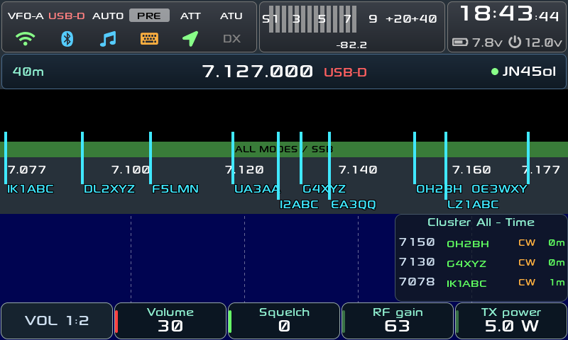
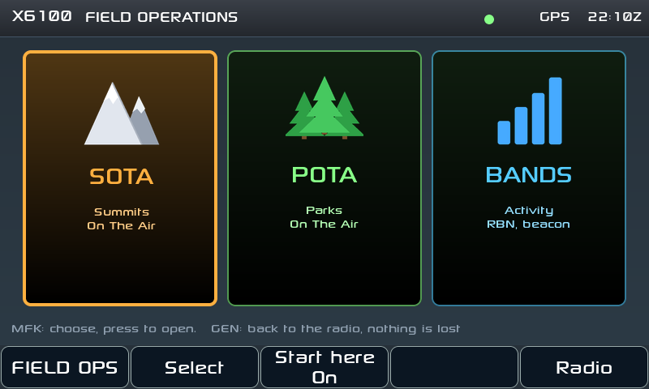
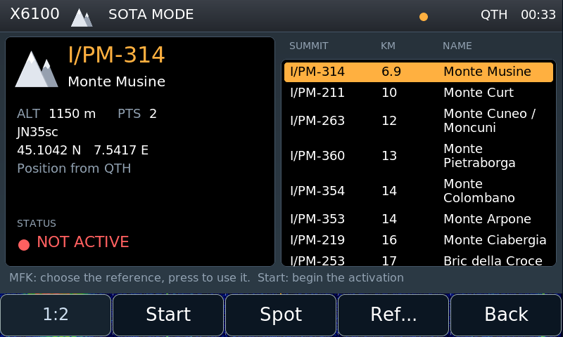
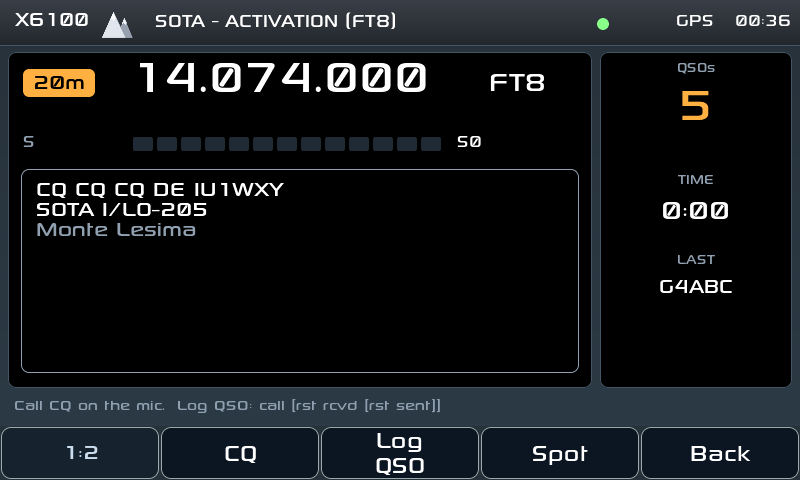
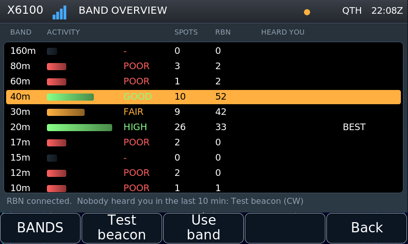
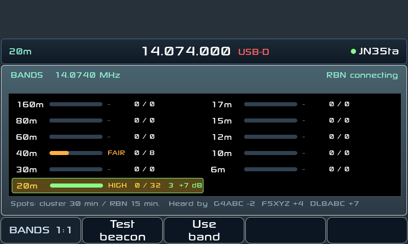
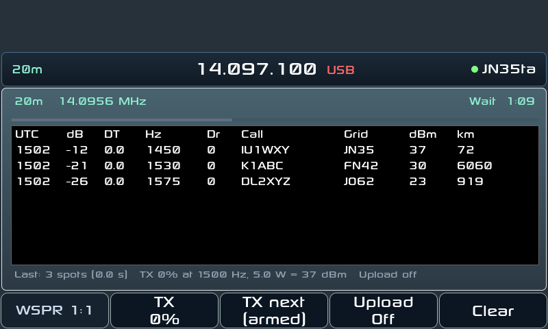
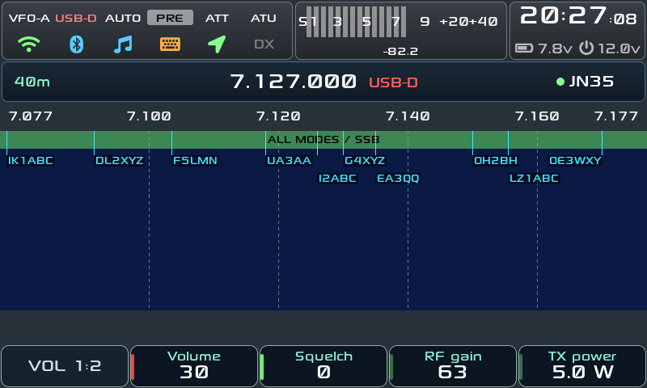
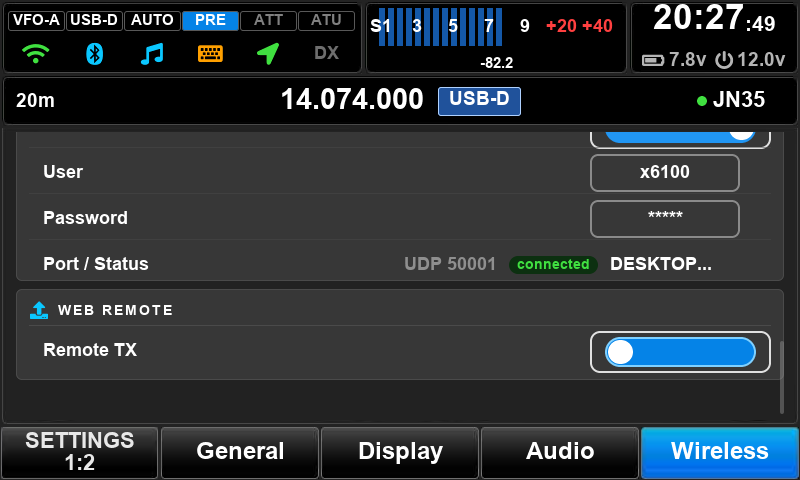

<h1 align="center">X6100 custom firmware</h1>

<i>by Giovanni Ricciardi IU1WXY</i>

<b>A complete SD-card firmware for the Xiegu X6100: every digital mode on the radio,
DX cluster on the waterfall, themes, and full remote control from your phone or a browser.</b>

> **First release: everything is beta, and this is only the beginning.**
> The GUI has been deeply rewritten: a new theme system draws every screen,
> button and font, so the look can change completely without touching the code.
> It runs daily on the author's radio, but expect rough edges. The
> **companion app is alpha**: transmitting from it works, test it on a dummy
> load first. Problems and ideas: open an issue.

## Remote control

**From your phone: X6100 Companion** (Android, [android/](android/)).
Turn on the phone's hotspot, let the radio join it, open the app: it finds the
radio by itself.

- The whole radio: frequency, band, mode, filters, S-meter, spectrum and
  waterfall, RX audio on the phone.
- **Every digital mode, receive and transmit**: FT8/FT4, JS8, WSPR, SSTV
  (pictures from the gallery or the camera), WeFax, RTTY, CW with macros,
  NavTex (receive). The radio decodes and transmits, the phone is the screen.
- Safe by default: the VFO is locked while an app runs (**BASE** brings it
  back), and the phone transmits only after you switch on **Remote TX** on the
  radio (Settings → Wireless → WEB REMOTE).
- **SOTA/POTA page** that opens by itself when the radio enters Field Ops:
  choose the reference, start the activation, log QSOs with the phone's
  keyboard, spot; the phone's GPS gives the radio its position.
- Portrait and landscape, English or Italian.

**From any browser: the built-in web server** (`http://<radio IP>/`, nothing
to install). The **Remote** page tunes the radio with live spectrum and
waterfall and plays the RX audio; the other pages set bands, memories, cluster,
backup, and a **gallery** with folders, multi-select, ZIP download and picture
upload for SSTV/WeFax TX.

**From a PC**: wfview (the radio appears as an IC-705 on the network) and CAT
over USB or Bluetooth.

<table>
  <tr>
    <td align="center"> Companion app: FT8</td>
    <td align="center"> CW with macros</td>
    <td align="center"> WeFax</td>
  </tr>
</table>

## Features on the radio

### Digital modes, all inside the radio

No PC, no sound card cable: APP → **Modes** opens them, the radio decodes and
transmits by itself.

- **FT8 / FT4**: decode, CQ, reply, auto sequence, QSO log in ADIF.
- **JS8**: JS8Call compatible, all four speeds decoded at once, inbox,
  relays, heartbeats, ADIF log with POTA/SOTA, **APRS** (position, spots,
  SMS, email).
- **WSPR**: decode every cycle, random beacon (TX %), upload to WSPRnet.
- **SSTV**: receive with automatic VIS, **transmit** CQ, replies and pictures
  with text templates (Martin, Scottie, Robot).
- **WeFax** and **NavTex**: station lists, faxes saved as pictures, big or
  full-screen view. WeFax and RTTY also transmit from the phone.
- **CW decoder**: the new upstream receiver, which copies down to about 0 dB
  SNR and shows the WPM, here tuned not to print noise.
- **CW Keyboard**: type on a USB or Bluetooth keyboard and the radio keys it,
  with a send queue.

### DX Cluster

- Spots drawn **on the waterfall**, in a **column** beside it, and in a full
  **Cluster app** that follows the VFO; tap or press to tune.
- Filters by mode, band and POTA/SOTA; **alerts** on callsigns and prefixes
  with a popup.
- **Newest first** and **all bands**: the column and the app can list the
  spots by time (the most recent on top, without the VFO marker row) and from
  every band, not only the current one (Settings → Cluster → CLUSTER VIEW, or
  the MFK while the column is shown).
- **Spot snap**: turning the knob slowly stops the VFO on a spot.
- Ten public servers built in, add your own from the web page.

<table>
  <tr>
    <td align="center"> <b>Cluster column</b> by frequency, around the VFO</td>
    <td align="center"> <b>Newest first</b>, all bands</td>
  </tr>
</table>

### Field Ops: SOTA and POTA

A second, separate interface made for portable activations, with big tiles and
big text that read well outdoors and work with gloves: APP (page 3) →
**Field Ops**, a long-press action, or straight at power on (**Start here**).
The main knob still tunes, the MFK chooses, a press (or a tap) opens.
**GEN** goes back to the normal radio screen.

<table>
  <tr>
    <td align="center"> <b>Home</b>: SOTA, POTA, Bands</td>
    <td align="center"> <b>SOTA</b>: the summit and the ones nearby</td>
  </tr>
  <tr>
    <td align="center"> <b>Activation</b>: CQ, log, spot</td>
    <td align="center"> <b>Bands</b>: live activity and who hears you</td>
  </tr>
</table>

**Where am I?** Field Ops finds the summit or park you are on by itself.
- The position comes from the radio's **GPS**, else from the **phone** (the
  companion app sends it), else from the **QTH locator**. A dot in the header
  tells which: green for a real position, yellow for the locator.
- The SOTA summits and POTA parks of the whole world (about 35 MB) are
  downloaded once over WiFi (**Update list**, about 3 minutes, or from the web
  page); after that everything works **offline**, on a summit with no signal.
- The nearest reference is chosen for you, with its name, altitude and points
  (SOTA), locator and distance; the others nearby are listed, and **Ref...**
  types one by hand.

**The activation.** **Start** opens it, and the screen becomes a dashboard
with the band, frequency, mode, S-meter, the CQ text with your reference, the
QSO count, the time since the start and the last call.
- **CQ** calls `CQ CQ SOTA DE <call>` (or POTA) in CW.
- **Log QSO** takes the call and the reports (599 / 59 by default) and writes
  the QSO at once to an **ADIF** file on the SD card, with `MY_SOTA_REF` or
  `MY_SIG POTA` / `MY_POTA_REF`: ready for the SOTA database, POTA or QRZ.
  The logs download from the web page.
- **Spot** self-spots you on **pota.app** with the radio's frequency and mode.
  For SOTA, post an alert on SOTAwatch and call CQ in CW: RBNHole spots you
  from the Reverse Beacon Network.
- **End**, pressed twice, closes the activation.

**Nothing is lost.** The reference, the activation running, its log and the
screen you were on live on the SD card: leave with GEN by mistake, switch off,
change the battery, and Field Ops comes back exactly where it was.

**On the phone.** When the radio enters Field Ops, the companion app switches
by itself to its SOTA/POTA page: the reference and the nearby ones to choose
with a tap, Start and End, and the QSO entry with the phone's keyboard (call,
RST sent and received), the QSO list in local time, Spot. The phone also
gives the radio its position.

### Bands: where is the band open, and who hears me?

A live picture of the HF bands from 160 to 6 m, inside Field Ops and as an
app of its own (APP page 3 → **Bands**), in the same look as the other apps.

<table>
  <tr>
    <td align="center"> Live on the radio: 20 m is the best band</td>
    <td align="center"> <b>Bands</b> app after a <b>Test beacon</b>: heard on 20 m by 3 skimmers</td>
  </tr>
</table>

- For every band: the **DX cluster** spots of the last 30 minutes and the
  **Reverse Beacon Network** skimmer spots of the last 15, merged into one
  activity bar and a word (**HIGH / GOOD / FAIR / POOR**). The best band is
  framed.
- **Test beacon**: the radio sends `TEST DE <call>` in CW. The RBN skimmers
  around the world that copy you show up within a minute in the **heard**
  column of each band, with how many heard you and the best SNR: a real
  propagation test from your own antenna, with your own power, before you
  start calling CQ. Then the info line says who heard you
  (`DK8NE +18 dB, OH6BG +7 dB...`), or tells you to try the beacon.
- **Use band** (or an MFK press) tunes a typical activation frequency of the
  chosen band, CW or phone as the radio's mode.
- RBN is connected only while the screen is open; it needs WiFi and your
  callsign. No account, nothing to install.

### Radio and screen

- **IARU band plan** strip over the waterfall, **S-meter**.
- **Long press** on every front key and on the mic F1/F2 keys: screenshot,
  recorder, mute, open any app or tool.
- Editable bands, memories and digital frequencies; transverters.
- RX recorder, screen recording, screenshots, voice messages.
- CW trainer, GPS, QTH grid, **SWR scan** across the band with the
  frequency labels on top.
- Times on screen in **local time** (time zone in Settings); logs and ADIF
  stay in UTC.
- Settings rewritten as cards, all reachable with the MFK.
- Tuning from **100 kHz** up (NAVTEX on 490 kHz included).

### Smooth screen, smooth knob

- **New display engine (DRM/KMS, from upstream)**: the screen is updated in
  step with the panel, so no tearing, and only the parts that change are
  redrawn. On top of it, a **layer system**: the GUI
  sits on its own transparent layer; the **waterfall** (and the spectrum, when
  it is on) is drawn straight onto the layer under it, one new line at a time.
  The GUI went from about 88% to about 47% of a CPU core: more room for the
  decoders, a cooler radio, a waterfall that scrolls evenly. Screenshots and
  screen recordings show both layers. On a kernel without DRM the classic
  framebuffer is used.
- **Main knob** (upstream design): every detent is timed by its own thread, so
  fast turns no longer stutter. **Acceleration** grows with the speed (Settings → General →
  CONTROLS: **Lite** or **Strong**), and **Accel. onset** (1-5) sets how fast
  you must turn before the step grows. Slow turns stay precise for spot snap.
- **CW tune indicator** (from upstream): the bar lights where the signal is and
  fades out a second after it stops.

### Wireless

- **Bluetooth CAT** for up to 3 clients at once, together with USB CAT.
- **Bluetooth headphones** (RX audio, volume, speaker mute) and **keyboards**;
  pairings survive a new image.
- **wfview**: the radio appears as an IC-705 on the network.
- **Web server** on the radio, HTTP and HTTPS (see [Remote control](#remote-control)).

<table>
  <tr>
    <td align="center"> <b>SSTV TX</b>: picture and text template</td>
    <td align="center"> <b>DX Cluster</b> app</td>
  </tr>
  <tr>
    <td align="center"> <b>JS8</b></td>
    <td align="center"> <b>WSPR</b></td>
  </tr>
  <tr>
    <td align="center"> <b>CW Keyboard</b></td>
    <td align="center"> <b>Modes</b> menu</td>
  </tr>
</table>

## Themes

The GUI has a new **theme system**: colours, buttons, corners, gradients,
fonts and the waterfall palette all come from the theme, and a theme can draw
every surface with PNG images. Four come with the firmware: choose one in
Settings → Display → **Theme** and the radio app restarts with it at once.
Your own go on the SD card ([how to make one](docs/THEMES.md)). The control
the encoder is adjusting lights its red LED.

**Outdoor** is made for the sun: light backgrounds, black text, strong
borders, switches and icons that stay visible when off, and a waterfall
palette that goes from pale blue to deep red and black, so the signals stand
out even in full daylight.

<table>
  <tr>
    <td align="center"> <b>IU1WXY</b> (default): dark blue-grey</td>
    <td align="center"> <b>Outdoor</b>: light, high contrast, for the sun</td>
  </tr>
  <tr>
    <td align="center"> <b>Classic</b>: black, grey keys</td>
    <td align="center"> <b>RS</b>: glossy buttons with LEDs, black LCD</td>
  </tr>
  <tr>
    <td align="center"> <b>RS</b>: settings</td>
    <td align="center"> <b>RS</b>: SSTV TX</td>
  </tr>
</table>

## Install

1. Download the microSD image (`X6100-IU1WXY-v<version>-sdcard.img`) and the
   companion app (`X6100-IU1WXY-v<version>-Companion.apk`) from the
   **[latest release](https://github.com/IU1WXY/X6100-IU1WXY/releases/latest)**.
2. Write it to a microSD card with [balenaEtcher](https://etcher.balena.io/) or Rufus.
3. Put the card in the radio and switch on. Settings and logs live on the card's
   DATA partition (`/mnt`).

Writing a new image erases DATA too: copy it to your PC first and back after
the first start (the [manual](docs/MANUAL.md) lists the files). A patched
baseband ([x6100_base_patch](https://github.com/gdyuldin/x6100_base_patch)) r12
or newer is recommended for the TX audio options.

## Documentation

- **[Manual](docs/MANUAL.md)**: every app and setting, the web pages, CAT commands, files, building
- [Remote API](docs/REMOTE_API.md): what the companion app talks to
- [Themes](docs/THEMES.md): make your own

## Credits

**Giovanni Ricciardi IU1WXY** designed and wrote this firmware:

- the deep **rewrite of the GUI** and the **theme system**, with the IU1WXY,
  Outdoor, Classic and RS themes and the new settings;
- the **X6100 Companion** app and the **remote control** of the radio (remote
  API, web Remote page, gallery, backup);
- **Field Ops** (SOTA/POTA activations, offline references, ADIF, POTA
  spots) and **Bands** (Reverse Beacon Network, test beacon);
- the **DX Cluster** (waterfall spots, column, app, filters, alerts, spot snap);
- **WSPR**, **SSTV TX**, **RTTY** and **WeFax TX**, the **CW Keyboard**, the
  integration of JS8, SSTV, WeFax and NavTex into the radio;
- **Bluetooth** CAT, headphones and keyboards, **wfview** server (Icom LAN
  protocol), IARU band plan strip, configurable long-press actions, CW trainer
  stats, and the SD image itself;
- the **layer system** on top of the DRM output (GUI on a transparent layer,
  waterfall and spectrum drawn directly underneath), and the **Accel. onset**
  setting of the main knob.

Standing on the work of: the **R1CBU** GUI by Oleg Belousov R1CBU and Georgy
Dyuldin R2RFE ([gdyuldin/x6100_gui](https://github.com/gdyuldin/x6100_gui)),
whose CW receiver, CW tune indicator, DRM/KMS display output, direct spectrum
rendering and main knob handling (detents timed in their own thread) are
imported here,
**1KO125** by Hany El Imam / TheMurusTeam (WeFax, NavTex, SSTV decoders),
**JS8** by randal007 on the JS8Call engine (Jordan Sherer KN4CRD), **wsprd**
from WSJT-X (K1JT, K9AN). Libraries: LVGL, cJSON, FFTW, liquid-dsp, libpng,
bottle, PulseAudio, BlueZ. Fonts: Roboto, DejaVu, Arial, Sony Sketch.
Hardware: Xiegu.

## License

The GUI is LGPL-2.1-or-later ([LICENSE](LICENSE)); the vendored js8core and
wsprd are GPLv3, so the firmware image is GPLv3. The web server has its own
license ([webserver/LICENSE](webserver/LICENSE)).
