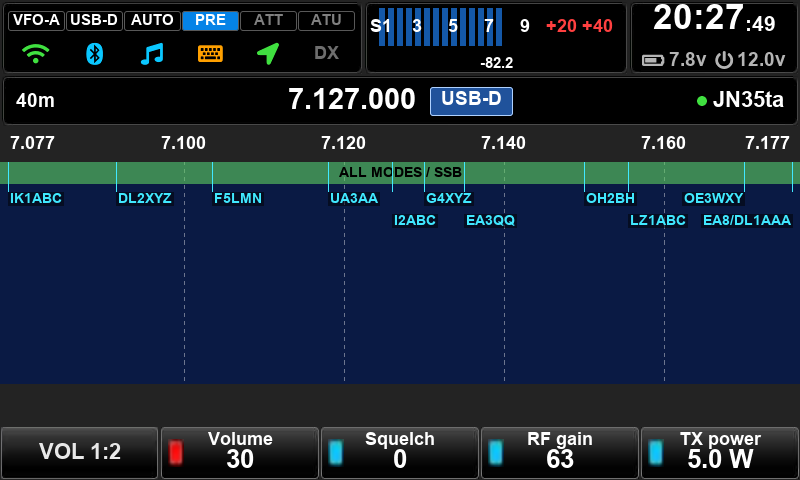
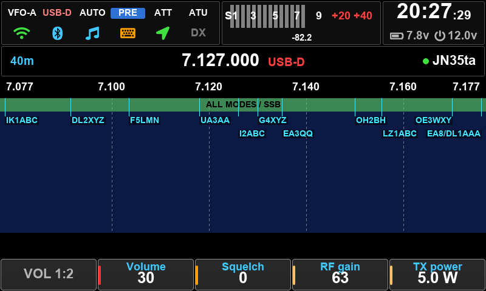
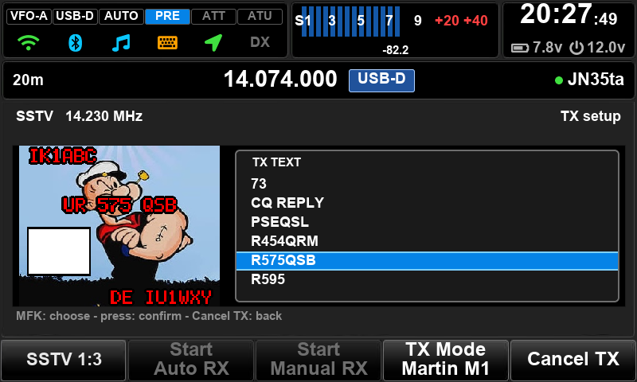
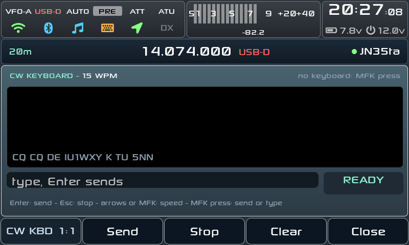

<h1 align="center">X6100 custom firmware</h1>

<i>by Giovanni Ricciardi IU1WXY</i>

<b>A complete SD-card firmware for the Xiegu X6100: every digital mode on the radio,
DX cluster on the waterfall, themes, and full remote control from your phone or a browser.</b>

> **First release: everything is beta, and this is only the beginning.**
> The GUI has been deeply rewritten: a new theme system draws every screen,
> button and font, so the look can change completely without touching the code.
> It runs daily on the author's radio, but expect rough edges. The
> **companion app is alpha**: transmitting from it works, test it on a dummy
> load first. Problems and ideas: open an issue.

## Remote control

**From your phone: X6100 Companion** (Android, [android/](android/)).
Turn on the phone's hotspot, let the radio join it, open the app: it finds the
radio by itself.

- The whole radio: frequency, band, mode, filters, S-meter, spectrum and
  waterfall, RX audio on the phone.
- **Every digital mode, receive and transmit**: FT8/FT4, JS8, WSPR, SSTV
  (pictures from the gallery or the camera), WeFax, RTTY, CW with macros,
  NavTex (receive). The radio decodes and transmits, the phone is the screen.
- Safe by default: the VFO is locked while an app runs (**BASE** brings it
  back), and the phone transmits only after you switch on **Remote TX** on the
  radio (Settings → Wireless → WEB REMOTE).
- Portrait and landscape, English or Italian.

**From any browser: the built-in web server** (`http://<radio IP>/`, nothing
to install). The **Remote** page tunes the radio with live spectrum and
waterfall and plays the RX audio; the other pages set bands, memories, cluster,
backup, and a **gallery** with folders, multi-select, ZIP download and picture
upload for SSTV/WeFax TX.

**From a PC**: wfview (the radio appears as an IC-705 on the network) and CAT
over USB or Bluetooth.

<table>
  <tr>
    <td align="center"> Companion app: FT8</td>
    <td align="center"> CW with macros</td>
    <td align="center"> WeFax</td>
  </tr>
</table>

## On the radio

| | |
|---|---|
| **Digital modes** | FT8/FT4, JS8 (all speeds, inbox, APRS), WSPR (beacon, WSPRnet upload), SSTV RX/TX, WeFax, NavTex, RTTY, CW decoder, CW Keyboard (USB or Bluetooth keyboard) |
| **DX Cluster** | spots on the waterfall, a column beside it and a full app; filters, alerts, spot snap |
| **Themes** | IU1WXY, Classic and RS built in, or your own from the SD card ([docs/THEMES.md](docs/THEMES.md)); the button on the encoder lights red |
| **Bluetooth** | CAT for up to 3 clients, headphones, keyboards |
| **More** | IARU band plan strip, S-meter, CW trainer, SWR scan, GPS, recorders, long-press actions, editable bands and memories |

<table>
  <tr>
    <td align="center"> <b>RS</b> theme</td>
    <td align="center"> <b>Classic</b> theme</td>
  </tr>
  <tr>
    <td align="center"> <b>SSTV TX</b>: picture and text template</td>
    <td align="center"> <b>DX Cluster</b> app</td>
  </tr>
  <tr>
    <td align="center"> <b>JS8</b></td>
    <td align="center"> <b>CW Keyboard</b></td>
  </tr>
</table>

## Install

1. Download `sdcard.<version>.img.zip` from **Releases**.
2. Write it to a microSD card with [balenaEtcher](https://etcher.balena.io/) or Rufus.
3. Put the card in the radio and switch on. Settings and logs live on the card's
   DATA partition (`/mnt`).

Writing a new image erases DATA too: copy it to your PC first and back after
the first start (the [manual](docs/MANUAL.md) lists the files). A patched
baseband ([x6100_base_patch](https://github.com/gdyuldin/x6100_base_patch)) r12
or newer is recommended for the TX audio options.

## Documentation

- **[Manual](docs/MANUAL.md)**: every app and setting, the web pages, CAT commands, files, building
- [Remote API](docs/REMOTE_API.md): what the companion app talks to
- [Themes](docs/THEMES.md): make your own

## Credits

Built on the **R1CBU** GUI by Oleg Belousov R1CBU, maintained by Georgy
Dyuldin R2RFE ([gdyuldin/x6100_gui](https://github.com/gdyuldin/x6100_gui)),
with the apps of **1KO125** by Hany El Imam / TheMurusTeam (WeFax, NavTex,
SSTV), **JS8** by randal007 on the JS8Call engine (Jordan Sherer KN4CRD), and
**wsprd** from WSJT-X (K1JT, K9AN). Libraries: LVGL, cJSON, FFTW, liquid-dsp,
libpng, bottle, PulseAudio, BlueZ. Fonts: Roboto, DejaVu, Arial, Sony Sketch.
Hardware: Xiegu. Themes, companion app and the rest: **Giovanni Ricciardi IU1WXY**.

## License

The GUI is LGPL-2.1-or-later ([LICENSE](LICENSE)); the vendored js8core and
wsprd are GPLv3, so the firmware image is GPLv3. The web server has its own
license ([webserver/LICENSE](webserver/LICENSE)).
