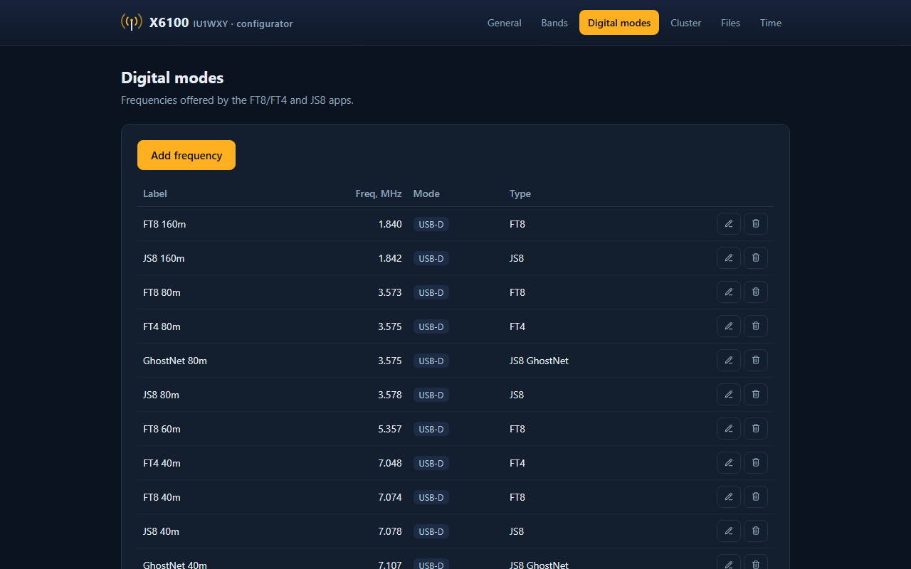
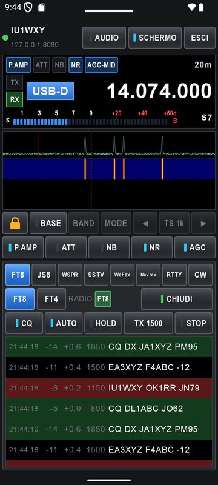
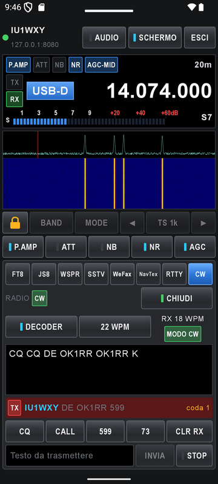
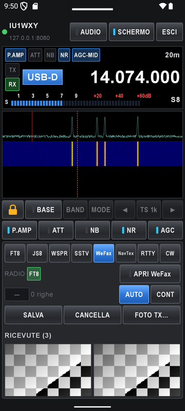
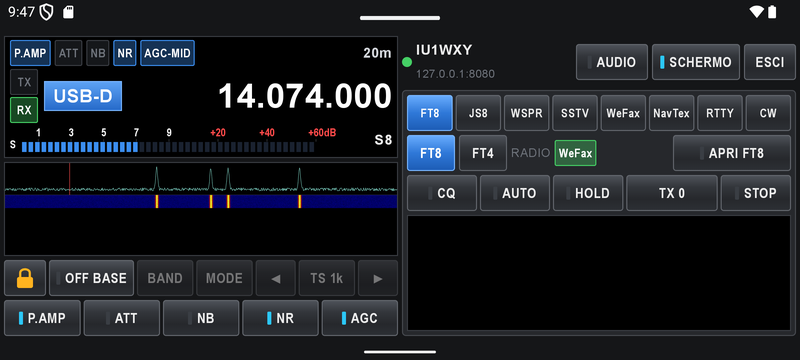

# X6100 custom firmware: manual

How to use every part of the firmware, and the reference tables. The short
overview is the [README](../README.md).

## Contents

- [Usage](#usage): digital modes, JS8, WSPR, SSTV/WeFax/NavTex, RTTY and WeFax TX, CW decoder, CW Keyboard, DX Cluster, Field Ops (SOTA/POTA), Bluetooth, themes
- [Web configurator](#web-configurator) and [companion app](#companion-app-android)
- [wfview server](#wfview-server), [Settings](#settings)
- [Reference](#reference): Bluetooth CAT, CI-V commands, btcat-ctl, btaudio-ctl, files on /mnt
- [Build](#build)

## Usage

### Digital modes

APP (page 1) → **Modes** opens a menu: RTTY, FT8, FT4, WSPR, JS8, SSTV, WeFax,
NavTex. Turn the **MFK** to choose, press to open; the last used mode is
marked. Pressing **Modes** again closes the menu.

APP buttons:

| Page | Buttons |
|---|---|
| 1 | Modes, Cluster, SWR Scan, GPS |
| 2 | Recorder, Settings, CW Trainer, CW Keyboard |
| 3 | Field Ops |

Your callsign and QTH locator are set in Settings → General → **STATION**.
Callsign is needed by JS8, FT8, WSPR (TX and upload) and the DX Cluster.

**Long press:** each button group (GEN, APP, KEY, MSG, DFN, DFL) has a
long-press action, chosen in Settings → **Keys** → FRONT KEYS, LONG PRESS:
none, screenshot, RX recorder or screen recording on/off, mute, waterfall
mode, a digital mode app (RTTY, FT8, WSPR, JS8, SSTV, WeFax, NavTex), a tool
(Cluster, CW Trainer, CW Keyboard, RX recorder, SWR Scan, GPS, QTH grid,
Settings). The
hand mic F1 and F2 keys (short and long press) are set in the same tab,
under HAND MIC KEYS.

Each app has its own button pages, named like `(JS8 1:6)`; press the first
button to go to the next page.

### JS8

Beta 3 of randal007's [X6100 JS8](https://github.com/randal007/x6100-js8):
a JS8Call-compatible decoder and keyboard in the radio, with all four speeds
(Normal, Fast, Turbo, Slow) decoded at once.


First steps:

1. Set callsign and QTH in Settings → General → STATION. JS8 will not send
   without a callsign.
2. The radio clock must be within about 2 s: WiFi sets it, or use **Time
   Sync** (page 3) after some stations have decoded. It shifts only JS8's own
   timing (a drift shown on the top line); hold the button to reset it.
3. APP → **Modes** → **JS8**. The radio tunes the nearest JS8 frequency;
   the band keys step through JS8Call's (or GhostNet's) frequencies, or type
   your own (**Freq**, page 6). While JS8 is open the RX filter is
   200-3000 Hz, noise reduction, noise blanker and notch are off, and power
   is capped at 5 W; all go back when you leave.
4. Turn the **MFK** onto a station's row, then **HW CPY?** (page 1),
   **Reply** (page 2) or **Query >** (page 1).
5. **ESC** or the top knob stops sending; the next ESC leaves the app.

Nothing sends by itself: AUTO (automatic replies), HB (heartbeats) and HB ACK
are off every time the app opens.

Buttons (the first one of each row turns the page, hold to go back):

| Page | Buttons |
|---|---|
| 1 | CQ (hold: auto CQ), Heartbeat, Query >, HW CPY? |
| 2 | Show: No HB / Directed / All, Reply, Send..., Clear |
| 3 | Time Sync, Hold: Off / On, Show Stations / Messages, Inbox |
| 4 | AUTO, HB, HB ACK, Settings... (INFO, STATUS, Relay, Groups) |
| 5 | APRS >, Log QSO, Activ.: Off / POTA / SOTA, Log prompt |
| 6 | Alerts >, Speed, Decode: All speeds / My speed, Freq: JS8 / GhostNet / kHz |

What it does:

- One-press messages (SNR?, GRID?, INFO?, STATUS?, HEARING?, AGN?, RR, 73),
  an **Inbox** for `MSG` messages, relays and store-and-forward like desktop
  JS8Call.
- **Log:** the Log popup (page 5, or when a QSO ends with 73/SK) saves to
  `js8call_log.adi` in desktop JS8Call's ADIF format, with POTA/SOTA
  activation fields. FT8 keeps its own `ft_log.adi`.
- **Alerts:** beeps for messages, CQs and new stations, and purple alert
  words.
- **APRS** through JS8 gateways: grid and GPS position beacons (optionally
  with a message), POTA and SOTA spots, SMS, email and Winlink.
- Rows in the list: blue sent by you, red to you, green a CQ, dark blue to a
  group, purple an alert word.

Known limits: relays, store and forward, and most APRS items are not yet
proven on the air (only the grid spot and SMS are). The main screen's
waterfall stands still while JS8 is open.

Design notes: [docs/RESEARCH.md](RESEARCH.md),
[docs/TX_PLAN.md](TX_PLAN.md), [docs/T6_PLAN.md](T6_PLAN.md),
[docs/SPOTS_PLAN.md](SPOTS_PLAN.md).

### WSPR

APP → **Modes** → **WSPR**. The radio tunes the nearest WSPR dial frequency
(USB-D, WSJT-X's list); the band keys step through the others. Cycles are
two minutes from the even UTC minute, so the clock must be right to about a
second (GPS or NTP).

- **RX**: every cycle not used for TX is decoded at 1:54; the spots go to the
  top of the table (UTC, SNR, DT, audio Hz, drift, call, grid, dBm, km from
  your QTH).
- **TX %** (0, 10, 20, 33, 50): the chance that a cycle is a beacon, chosen at
  random as in WSJT-X. **TX next** sends one beacon in the next cycle (press
  again to stop it, also on the air). The message is the callsign, the first
  4 characters of the locator and the power (Settings, at most 5 W, rounded
  to a WSPR level). Compound calls with a `/` can't be sent.
- The main knob moves the TX audio offset (1410 - 1590 Hz).
- **Upload**: the spots of each cycle go to WSPRnet (plain HTTP over WiFi);
  the status line counts what was sent and what failed.

### SSTV, WeFax and NavTex

These apps work on known frequencies, so they don't need the waterfall: they
fill the screen in the same look as WSPR and **Freq.** opens the list to
tune from (the MFK chooses, a press tunes). The header shows the station or
frequency and the receiver state; leaving the app gives the VFO back.

- **NavTex**: NAVTEX 518 kHz, NAVTEX HF 4209.5 kHz and the HF MSI
  frequencies; the MFK scrolls the text. (490 kHz is below the radio's
  500 kHz limit, so it is not in the list.)
- **WeFax**: DWD, Northwood and Athens stations. **View** (page 2) chooses
  Big (default), Full (the whole fax) or Small, the old low panel that keeps
  the main waterfall visible above it.
- **SSTV**: calling frequencies, LSB on 80 and 40 m (3.735, 3.845, 7.165,
  7.171 MHz) and USB above (14.230, 14.233, 18.160, 21.340, 24.975, 28.680,
  50.510 MHz). The picture is on the left, the decoder state on the right and
  the decoding progress in the thin bar under the header. The decoder is
  TheMurusTeam's 1KO125 beta8 one, with a tolerant VIS detection.

SSTV buttons:

| Page | Buttons |
|---|---|
| 1 | Start Auto RX, Start Manual RX, RX Mode (Manual RX), **TX** |
| 2 | Freq., RX Pics Browser, Delete picture, **Auto RX Restart** (on: a new VIS during a picture starts a new one) |
| 3 | Test RX, Close (ESC also closes) |

**SSTV TX.** **TX** opens the TX menu (turn the MFK, press to choose):

- **CALL CQ**: a picture with CQ CQ SSTV and your callsign on it.
- **REPLY TO** / **REPLAY TO** the target callsign: the reply text on a
  picture; Replay adds a miniature of the last received picture.
- **TX IMAGE ONLY**: the picture without text. **REPEAT LAST TX** sends the
  last transmission again.
- **SET TARGET CALLSIGN**: type the other station's call (Reply and Replay
  need it).

Then choose the picture, the text (templates like `R575QSB`, `PSEQSL`, `73`)
and its colours; the next press transmits. **TX Mode** chooses Martin,
Scottie or Robot, **Cancel TX** goes back, **Halt TX** stops on the air. TX
goes through the same player as FT8 and WSPR: power at most 5 W, level
corrected from ALC and power. Pictures are in `/mnt/sstv/tx_pics`, text
templates in `/mnt/sstv/tx_text`; the default ones are copied there at the
first start. Received pictures are saved in `/mnt/sstv`. Pictures can be
uploaded from the web configurator's Gallery or sent from the phone.

### RTTY and WeFax TX

RTTY and WeFax transmit only from the [companion app](#companion-app-android)
(or the [remote API](REMOTE_API.md)); the radio has no local TX button
for them.

- **RTTY TX**: ITA2 AFSK with the RTTY app's rate, shift, centre and
  reverse, through the same TX player.
- **WeFax TX**: a picture in grey, 1809 px wide (IOC 576), 120 LPM, with APT
  start and stop tones and phasing, at most 800 lines. Pictures go to
  `/mnt/wefax/tx_pics` (uploaded from the phone or the Gallery).
- **NavTex** is receive only.

### CW decoder

In CW mode the decoder buttons are on the CW pages (**CW 1:2**, **2:2**):
**Decoder** on/off, **Tuner** (tuning indicator), **Dec SNR**, **CW peak** and
**CW peak Q**. Text and speed (WPM) appear in the panel over the waterfall.

- The receiver comes from gdyuldin x6100_gui 1.0.1: a coherent tone tracker
  that follows the station inside the CW filter, a detector with a noise
  floor, and a time classifier that learns the speed. On test signals it copies
  98-100% from 20 dB down to 0 dB SNR (in 2.5 kHz) and still 97-100% at -3 dB;
  the old decoder stopped at about +5 dB. The WPM reading is within about 0.5 WPM.
- **Dec SNR** (5-30 dB, default 8) is how far over the noise floor a mark must
  be. Lower copies weaker signals but can print noise; it starts at 8 for
  everyone after this update.
- No characters from noise: lone blips, clicks and steady carriers (birdies) on
  the tone are not decoded and do not change the speed estimate.
- A letter shows when the next one starts; the last one after a short pause.
  For 1 s after the decoder is reset (first use, CW peak or key tone change)
  nothing is decoded. A key-down longer than 8 dots (tune-up) is ignored.
- Upstream bugs fixed here: a strong station slightly off tune was never
  decoded, and a dash cut by a retune came out as a dot.

### CW Keyboard

APP (page 2) → **CW Keyboard** keys what you type on a USB or Bluetooth
keyboard (pair a Bluetooth keyboard in Settings → Wireless → BLUETOOTH; it
is found again when it reconnects). The radio must be in CW or CW-R (the
state box says NOT CW otherwise).

- **Enter** (or **Send**) keys the line; lines typed while sending wait in a
  queue. In the log the sent text is dim, the line on the air is bright up
  to the key and highlighted after it, the queue is grey.
- **Esc** (or **Stop**) stops sending. The arrow keys or the MFK change the
  speed (WPM, the key speed of the radio).
- Without a keyboard an MFK press opens the on-screen keyboard.

The companion app's CW tab uses the same keyer.

### DX Cluster


Needs WiFi (Settings → Wireless) and your callsign (Settings → General →
STATION), used to log in. The client connects in the background as soon as
both are there, and reconnects by itself (with a backoff) after an error or
when WiFi comes back. Spots older than 60 minutes are dropped. After login it
asks for the latest 50 spots (`sh/dx`).

**Cluster app** (APP → Cluster; pages `(CLUSTER 1:2)` and `(CLUSTER 2:2)`):

- The spots of the **current band**, sorted by frequency, with a VFO marker
  row among them. The list stays centred on the VFO: tuning scrolls it and
  selects the nearest spot. Spots within 3 kHz of the VFO are highlighted; a
  green `*` marks spots less than 2 minutes old.
- **MFK** turns browse the list (this stops the VFO following). An MFK press,
  the **Tune** button or a tap on a row tunes to the spot. The mode comes from
  the comment (CW, FT8, SSB, ...) or else from the band plan: CW, USB-D on
  the FT8/FT4 frequencies, LSB below 10 MHz, USB above.
- Page 1: **Band / All** switches between the current band and all bands
  (always all when the VFO is outside the amateur bands); the button shows
  the view (`Band / 20m`, `Band / All`). **Tune**, **Mode** (All → CW → SSB →
  DIG, a quick view filter), **Close**.
- Page 2: **Server** opens the list of saved servers: MFK to choose, press (or
  tap) to use it, **Server** again or ESC to close. The choice is saved in
  `/mnt/cluster.conf`. **Order**: by frequency around the VFO (`Freq`) or
  newest first (`Time`).
- Order and band view are saved and shared with the cluster column.
- The status line shows WiFi/cluster state ("Set your callsign", "WiFi not
  connected", "Connecting...", "cluster connected", or the error and
  "retrying").

**Filters and alerts** (saved in `/mnt/cluster.conf`, shared by the radio and the web configurator):

- **On the radio** (Settings → **Cluster**): modes (CW, SSB, DIG, AM/FM),
  bands (160-6 m, all on = no filter) and activity (All spots, POTA, SOTA,
  POTA + SOTA). One mode and one band always stay on. A change applies at once.
- **POTA / SOTA** come from the spot comment: the word POTA or SOTA, a park
  reference (`US-1234`, `IT-0123`) or a summit reference (`I/LO-123`,
  `W7W/KG-001`). WWFF references (`IFF-0123`) are not taken as POTA.
- **Web configurator → Cluster**: the same modes, bands and activity, plus
  maximum age and spotters to skip (`*` wildcard).
- The filters apply to the app, the column and the waterfall.
- **Alerts**: callsigns or prefixes (`3B8M`, `VP8*`, `*/MM`), optionally
  only on some bands or one mode. Matching spots are magenta with an `ALERT`
  tag and are never filtered out; a new one pops up on the main screen for
  10 s (MFK press tunes it).

**Main screen** (Settings → Display → MAIN SCREEN):

- **Cluster spots**: a short cyan line at each spot frequency at the top of
  the waterfall (across the band plan strip) and the callsign under it, in
  two staggered rows on a dark see-through background; alert calls are pink.
  The waterfall does not move.
- **Spot snap hold** (0-5, 0 = off) and **Spot snap speed** (1-5): with the
  cluster spots shown, turning the main knob slowly (at most *speed* detents
  at a time) stops the VFO on a spot it passes for *hold* more detents.
  Turning fast goes past. Without the cluster spots there is no snap.
- **Cluster column**: a box at the right of the waterfall (80 % opaque) with
  the spots (kHz, callsign, mode, age) around the VFO marker row, coloured by
  age: green under 2 minutes, yellow under 10, amber under 30, grey older.
  The title shows the view (`Cluster 40m - Freq`). While the column is shown,
  the MFK has two more items, **Cluster order** (Freq / Time) and **Cluster
  bands** (Band / All), the same settings as in the app.

Both use the same client as the app.

**Servers:** if `/mnt/cluster.conf` has no `server=` lines the app lists ten
public clusters (VE7CC, W3LPL, K1TTT, NC7J, W1NR, WA9PIE, K4ZR, DB0SUE,
GB7DJK, AE5E). The default is `dxc.ve7cc.net` port 23. Add and remove servers
from the [web configurator](#web-configurator) or in the file
([format](#files-on-mnt)).

### Field Ops (SOTA / POTA)

A full-screen interface for portable activations: APP (page 3) → **Field Ops**,
or a long-press action. **GEN** or **Radio** goes back to the normal screen;
everything (the reference, the activation running, its log, the screen you
were on) is kept on the SD card in `/mnt/field`, so coming back, or a restart in
the middle of an activation, finds it as it was. **Start here** (home screen)
opens Field Ops at power on.

- **Home**: the SOTA, POTA, Bands and Log tiles (MFK to choose, press to open).
- **SOTA / POTA**: the nearest summits or parks with their distance; the nearest
  one is taken, the MFK and a press choose another, **Ref...** types one. The
  position comes from the radio's GPS, else from the phone (the companion app
  sends it), else from the QTH locator.
  - **Start** begins the activation and its ADIF log
    (`/mnt/field/logs/<date>-<time>_<ref>.adi`, with `MY_SOTA_REF` or
    `MY_SIG POTA` / `MY_POTA_REF`); **End**, pressed twice, ends it.
  - **Log QSO**: type `CALL`, or `CALL rst_rcvd rst_sent` (default 599 in CW,
    59 otherwise); each QSO is written to the SD card at once.
  - **Spot**: POTA self-spot on pota.app with the frequency and mode of the
    radio (WiFi needed). SOTAwatch spots are not available yet (they need an
    API client approved by SOTA): post an alert on SOTAwatch and call CQ in CW,
    RBNHole spots you from the Reverse Beacon Network.
  - **Update list** (page 2): downloads the parks and summits (about 35 MB,
    once; then it works offline).
- **Bands**: for each band the cluster spots of the last 30 minutes, the RBN
  skimmer spots of the last 15 and the skimmers that heard you in the last 10,
  with the best band marked. **Test beacon** sends `TEST DE <call>` in CW (the
  radio must be in CW) so you can see who hears you; **Use band** (or a press)
  tunes a typical activation frequency of the band.
- **Log**: the QSOs of the activation; **Upload QRZ** sends them to the QRZ
  Logbook (the API key goes in the web configurator's **Field** page; QSOs
  already there are skipped). The logs can be downloaded from the same page.

No POTA or SOTA spot goes to the DX cluster: neither program reads them there.

### Bluetooth headphones

Radio RX audio to A2DP headphones. Pairing and connection are in Settings →
Wireless → BLUETOOTH; the audio switches are in Settings → Audio → **BT
HEADPHONES**.

1. Settings → Wireless: switch **Bluetooth** on, put the headphones in
   pairing mode and press **Scan headphones** (15 s).
2. MFK press on a device marked *new* pairs, trusts and connects it. On a
   paired device the menu offers Connect / Disconnect, **Connect at
   startup** and Remove.
3. Settings → Audio → BT HEADPHONES, with the headphones connected:
   - **RX to headphones**: a PulseAudio loopback from the radio RX audio
     (`alsa_input.platform-sound.stereo-fallback`) to the headphones.
   - **Headphone volume**: the headphones sink volume.
   - **Mute speaker**: AF volume 0 while the headphones are connected, back
     to the previous value when they disconnect. The AF volume does not change
     the audio sent to the headphones.

Only A2DP is used: HFP/HSP (SCO) gives no audio on this radio and drops the
WiFi, so PulseAudio has no headset backend
(`rootfs/etc/pulse/system.pa.d/btaudio.pa`). The same file stops PulseAudio
from looping a phone or tablet that connects for CAT (it also appears as an
A2DP source) into the radio TX audio.

Bluetooth keyboards (for the [CW Keyboard](#cw-keyboard)) are paired the
same way: **Scan headphones** also finds keyboards, which are marked
*keyboard* in the list.

Pairings are kept in a backup on `/mnt` and restored at boot
(`S39btpairings`), so a new image does not forget them.

### Bluetooth CAT

`btcat` (`btcat/btcat.c`) opens the real CAT UART (`/dev/ttyS2`) and
bind-mounts a pty over it, so the GUI talks to btcat. USB CAT and up to 3
Bluetooth clients share the CAT port: one request at a time, replies go back
to whoever asked, transceive frames (dst `0x00`) go to everyone.

Settings → Wireless → BLUETOOTH:

- **Bluetooth**: adapter power.
- **Discoverable (CAT)**: always visible, or only already paired devices can
  connect.

Pair with Just Works (no PIN). On Linux: `rfcomm connect /dev/rfcomm0
<BT-MAC> 1`, then use `/dev/rfcomm0`. On Windows and Android the paired
device exposes an outgoing COM/SPP port. Log files: `/tmp/btcat.log`,
`/tmp/btcat-setup.log`.

### Themes

Every colour of the GUI comes from a **role** (background, button, selected
row, header text, OK, TX, ...); a theme gives each role a colour, plus
corners, borders, gradients, the font and the waterfall palette. Choose it in
Settings → Display → INTERFACE → **Theme**; it applies at the next start.

| Theme | Look |
|---|---|
| IU1WXY | default: dark blue-grey, cyan headers |
| Classic | black, grey keys, IC-7300 style |
| RS | RS-BA1 look: glossy buttons with LEDs, black LCD, Arial; drawn with images |
| your files | `/mnt/themes/<name>.json`, or a folder `/mnt/themes/<name>/theme.json` with PNG images |

A theme file sets only what it changes, the rest comes from its `base`
theme. A folder theme can draw the background, the buttons (normal, active,
disabled, page), the top bar, the frequency strip, the app windows and the
encoder LED with PNG images, 9-sliced to the size of each surface. RS is such
a folder: it is installed with the image and copied to `/mnt/themes/RS` at
the first start (`themes/RS`, generated by `themes/make_rs.py`). Legacy and
Outdoor are kept in the code but not offered in the menu. File format,
images and the list of roles: [docs/THEMES.md](THEMES.md).

**Encoder LED.** The bottom buttons show which encoder their control is on;
the control the encoder adjusts now has a red LED, which follows button
presses and encoder changes. A theme can draw the LED with an image.

**Fonts.** Sony Sketch, Roboto and DejaVu (default) are in Settings →
Display → INTERFACE → Font; Arial is set by a theme's `font` (the RS theme
uses it); its LVGL sizes are generated with `tools/font_gen.py`.

### Web configurator

A small web server (vendored in [webserver/](../webserver/), Python/bottle) runs
on the radio on port 80: open `http://<radio IP>/` from any browser on the
same network. Pages:

| Page | Does |
|---|---|
| General | index of the pages below |
| Bands | edit the band list |
| Digital modes | add, edit and delete digital mode frequencies |
| Cluster | DX cluster servers, filters and alerts (writes `/mnt/cluster.conf`) |
| wfview | enable the wfview server, set user and password |
| Memories | MEM 1-9 slots and the named channel list |
| Remote | tune the radio from the browser: frequency, mode, band, filter, RF gain, PRE/ATT/AGC/NB/NR, live spectrum and waterfall (click or drag to tune), RX audio (HTTPS page, one listener). The page itself is receive only (no PTT); transmitting remotely is done by the [companion app](#companion-app-android) |
| Backup | download settings, memories, cluster, wfview, QSO log, voice messages (optionally CW trainer and WiFi) as one file, and restore the parts you choose |
| Gallery | a folder per kind (screen recordings, voice recordings, screenshots, SSTV and WeFax received and to send) with count and size; multi-select (tap, checkbox, shift for a range, all/none), delete the selection with one confirmation or download it as a ZIP; upload several pictures into the SSTV and WeFax TX folders (other formats are converted to PNG in the browser); convert AVI to MP4 in the browser or on the radio (ffmpeg) |
| Field | QRZ Logbook API key, update the parks and summits list, download the activation logs |
| Files | browse `/mnt` |
| Time | local and server time, NTP sync, timezone |

The server also listens on HTTPS, port 443, with a self-signed certificate made
on first start (valid 10 years, stored in `/mnt/https/`). The browser shows a
certificate warning once; accept it. In-browser MP4 conversion in the Gallery
only works on the HTTPS page (WebCodecs needs a secure context); "Convert on
radio" works on both.

The radio picks up changes within a few seconds. Server options: `--host`,
`--port`, `--https-port` (0 = off), `--cert-dir`, `--db`, `--cluster-conf`, `--filebrowser-path`; see
[webserver/README.md](../webserver/README.md).

| Cluster | Digital modes |
|---|---|
|  |  |

The same server carries the remote API of the companion app (`/api/info`
for discovery, `/api/remote` commands, `/api/remote/stream` events,
`/api/remote/audio` RX audio): [docs/REMOTE_API.md](REMOTE_API.md).

### Companion app (Android)

**X6100 Companion** ([android/](../android/)) is a phone remote: dark panels,
black LCD, glossy buttons with LEDs, Arial. The radio decodes and transmits;
the phone shows and commands it over WiFi.

- **Radio**: frequency, band, mode, tune steps, P.AMP/ATT/NB/NR/AGC, S-meter,
  spectrum and waterfall (tap to tune), RX audio.
- **Apps**, all eight, with TX in all but NavTex: FT8/FT4 (CQ, reply, auto, hold, TX
  frequency), JS8, WSPR, SSTV (pictures from the phone's gallery or a camera
  photo, call and text), WeFax (received faxes full screen, zoom, save,
  share; send a picture), NavTex (receive only), RTTY and CW (text to send,
  macros with `{CALL}`, the characters already on the air in cyan).
- **VFO lock**: while an app is open on the radio, frequency, band, mode and
  tap-to-tune are locked (padlock to unlock). **BASE** goes back to the
  app's frequency and mode (*OFF BASE* blinks when the VFO is elsewhere). In
  FT8/FT4 a tap on the waterfall sets the TX audio frequency.
- **Portrait** (radio on top, app below) and **landscape** (side by side);
  rotation keeps the connection.

Connect: turn on the phone's hotspot, connect the radio to it (Settings →
Wireless), open the app: it tries the last radio, otherwise scans the
phone's networks for `/api/info`. Tap the radio found, or type its IP.

**Transmitting from the phone** needs Settings → Wireless → WEB REMOTE →
**Remote TX** on the radio (off by default); until then the app shows a red
"Remote TX off" banner and every TX command is refused. Stop always works.
When an app opened from the phone changed the mode (CW, or USB for
SSTV/WeFax/NavTex), the mode comes back when the app closes.

Building the APK (JDK 17, Android SDK 35, `./gradlew assembleDebug`):
[android/README.md](../android/README.md). Labels in English or Italian (the app's settings).

<table>
  <tr>
    <td align="center"><br><sub><b>FT8</b>, portrait</sub></td>
    <td align="center"><br><sub><b>CW</b>: macros, text on the air</sub></td>
    <td align="center"><br><sub><b>WeFax</b>: received faxes, picture TX</sub></td>
  </tr>
  <tr>
    <td colspan="3" align="center"><br><sub><b>Landscape</b>: radio on the left, app on the right.
    App screenshots taken on an emulator against a mock radio (fake data).</sub></td>
  </tr>
</table>

### wfview server

The radio can act as an Icom IC-705 on the network, so
[wfview](https://wfview.org) on a PC controls it with CI-V, RX audio and the
waterfall.

- **Off by default.** Enable it in Settings → Wireless (wfview card) or on
  the web configurator's **wfview** page. Default login `x6100` / `x6100`:
  change it in the same places (stored in `/mnt/wfview.conf`).
- Ports: UDP **50001** (control), **50002** (CI-V), **50003** (audio).
- In wfview add a network radio (IC-705 profile): radio IP, control port
  50001, the user and password above, audio codec **LPCM 1ch 16bit**.
- The Wireless card shows the connected client name.

### Settings

APP (page 2) → **Settings**. Tabs on two button pages: General, Display,
Audio, Wireless (page 1), Keys, Cluster and Info (page 2).

| Tab | Cards |
|---|---|
| General | STATION (callsign, QTH locator), DATE / TIME, CONTROLS (frequency acceleration, charger), TX CALIBRATION (IQ offsets, band output gain), TRANSVERTERS (from, to, shift) |
| Display | BACKLIGHT, WATERFALL (mode, auto level, manual min/max, line and zoom, smooth scroll), MAIN SCREEN (band plan, cluster spots, spot snap hold and speed, cluster column), INTERFACE (popups, knob info, font, theme) |
| Audio | RX AUDIO, TX AUDIO (codec gain, compressor, filter, CESSB, FM emphasis), MICROPHONE, VOX, AGC, BT HEADPHONES |
| Wireless | WIFI (power, status, IP, networks), BLUETOOTH (power, Discoverable (CAT), device list, Scan headphones, also keyboards), WFVIEW SERVER (on/off, user, password, port and client), WEB REMOTE (Remote TX: lets the companion app transmit, default off) |
| Keys | FRONT KEYS, LONG PRESS (GEN, APP, KEY, MSG, DFN, DFL), HAND MIC KEYS (F1, F2, F1 long, F2 long) |
| Cluster | CLUSTER FILTERS (modes, bands, POTA/SOTA activity) |
| Info | app and base firmware versions |

The MFK walks the controls and stops at the first and last one; there the
page shows its top or its end, so status rows below the last control are
always in view. A new Font or Theme applies at the next start (the screen
says so when you change it). Some cards depend on the base firmware revision (TX AUDIO, band output
gain, TX filter, CESSB, FM emphasis).

## Reference

### Bluetooth CAT: connection

| | |
|---|---|
| Transport | Bluetooth SPP, RFCOMM channel 1 (or USB CAT) |
| SPP UUID | `00001101-0000-1000-8000-00805F9B34FB` |
| Pairing | Just Works, no PIN; device name `X6100` (`BTCAT_ALIAS` in `/etc/default/btcat`) |
| Protocol | Icom CI-V, radio address `0xA4` |
| Frame | `FE FE A4 <ctrl> <cmd> [sub] [data] FD`; reply `FB` = OK, `FA` = NG |
| Baud (USB) | 19200 8N1 (ignored over BT) |
| Hamlib / flrig / wfview | rig model Xiegu X6100 |

### Supported CI-V commands

| Cmd | Sub | Function | Read | Write |
|---|---|---|:-:|:-:|
| `00` | - | Frequency (transceive, sent automatically on every change) | - | yes |
| `03` | - | Read frequency | yes | - |
| `04` | - | Read mode | yes | - |
| `05` | - | Set frequency (5 BCD bytes) | - | yes |
| `06` | - | Set mode (`00` LSB, `01` USB, `02` AM, `03` CW, `05` NFM, `07` CW-R) | - | yes |
| `07` | - / `00` / `01` / `A0` / `B0` | VFO: read current, VFO A, VFO B, A=B, swap A/B | yes | yes |
| `0F` | - | Split off/on | yes | yes |
| `10` | - | Tuning step (`00` 10 Hz, `01` 100 Hz, `02` 500 Hz, `03` 1 kHz, `04` 5 kHz) | yes | yes |
| `11` | - | Attenuator | yes | yes |
| `14` | `01` | AF volume (0-255) | yes | yes |
| `14` | `02` | RF gain (0-255) | yes | yes |
| `14` | `03` | Squelch (0-255) | yes | yes |
| `14` | `09` | CW pitch (0-255 = 300-900 Hz) | yes | yes |
| `14` | `0A` | TX power (0-255 = 0-10 W) | yes | yes |
| `14` | `15` | Monitor level | yes | - |
| `15` | `02` | S-meter (Icom scale, 120 = S9, for network clients) | yes | - |
| `15` | `11` | TX power meter | yes | - |
| `15` | `12` | SWR meter | yes | - |
| `15` | `13` | ALC meter | yes | - |
| `16` | `02` | Preamp | yes | yes |
| `16` | `22` | Noise blanker | yes | yes |
| `16` | `40` | Noise reduction | yes | yes |
| `16` | `44` / `46` | Compressor / VOX (always off, write ignored) | yes | - |
| `19` | `00` | Transceiver ID (returns `A4`) | yes | - |
| `1A` | `01` | Band (Icom codes `01` 160 m ... `09` 10 m, `10` 6 m, `15` none); write tunes the band's centre | yes | yes |
| `1A` | `03` | IF filter width (BCD index) | yes | - |
| `1A` | `06` | Data mode + filter; write only adds or drops the data mode (USB ↔ USB-D, LSB ↔ LSB-D) | yes | yes |
| `1C` | `00` | PTT (`00` RX, `01` TX) | yes | yes |
| `25` | `00` / `01` | Frequency of selected / unselected VFO | yes | yes |
| `26` | `00` / `01` | Mode + data mode of selected / unselected VFO | yes | yes |
| `27` | `10` / `11` | Scope on (always) / wave data output: waterfall data (about 30 frames/s) only to network clients (wfview); on serial and Bluetooth a stub | yes | yes |
| `27` | `14` / `15` | Scope centre mode (always centre) / span (follows the waterfall zoom, write sets the zoom) | yes | yes |
| `27` | `19` | Scope reference level (stub) | yes | - |

Anything else returns `FA` (NG).

Example, read frequency: `FE FE A4 E0 03 FD` →
`FE FE E0 A4 03 00 50 07 14 00 FD` (14.075.000 Hz).

### btcat-ctl

| Command | Effect |
|---|---|
| `btcat-ctl bt on\|off` | Bluetooth adapter power (= Settings → Wireless → Bluetooth) |
| `btcat-ctl discoverable on\|off` | Always visible / only paired devices (= Discoverable (CAT)) |
| `btcat-ctl status` | Print current settings |
| `btcat-ctl apply` | Re-apply settings from `/mnt/btcat.conf` |
| `/etc/init.d/S94btcat start\|stop\|restart` | Start/stop the bridge (set `BTCAT_ENABLE=no` in `/etc/default/btcat` to disable) |

### btaudio-ctl

Used by Settings → Wireless and Audio.

| Command | Effect |
|---|---|
| `btaudio-ctl list` | Paired devices and audio state (tab separated) |
| `btaudio-ctl scan` | 15 s scan, prints the new headphones and keyboards found |
| `btaudio-ctl pair MAC` | Pair, trust and connect |
| `btaudio-ctl connect\|disconnect\|remove MAC` | Manage a device |
| `btaudio-ctl autoconnect MAC on\|off` | Connect at startup |
| `btaudio-ctl rx on\|off` | RX audio to the headphones (loopback) |
| `btaudio-ctl volume N` | Headphone volume, 0-100 % |
| `btaudio-ctl mute on\|off` | AF volume 0 while headphones are connected |
| `btaudio-ctl boot` / `monitor` | Started by `btcat-setup`: keeps the headphones on A2DP with the loopback up, connects the "Connect at startup" devices |

### Files on /mnt

The DATA partition, readable on a PC.

| File | What |
|---|---|
| `params.db`, `qso_log.db` | the radio's settings and QSO database |
| `cluster.conf` | DX cluster server in use, saved servers, filters and alerts |
| `cw_trainer.json` | CW trainer statistics and Calls best score |
| `wfview.conf` | wfview server on/off, user and password |
| `btcat.conf` | Bluetooth power and Discoverable (CAT), written by `btcat-ctl` |
| `btaudio.conf` | headphones settings (RX loopback, speaker mute, Connect at startup devices) |
| `ft_log.adi`, `js8call_log.adi` | FT8/FT4 and JS8 logs (ADIF) |
| `js8_inbox.txt`, `js8_held.txt`, `js8_texts.txt` | JS8 inbox, messages held for others, INFO/STATUS/alert words/groups |
| `incoming_log.adi` | put an ADIF log here to import it at the next start |
| `themes/` | theme files and folders ([docs/THEMES.md](THEMES.md)); RS is copied here at the first start |
| `sstv/` | received SSTV pictures; `tx_pics/` pictures and `tx_text/` text templates to send |
| `wefax/` | received faxes; `tx_pics/` pictures to send |

`cluster.conf` example (the `host=`/`port=` lines are the server in use, each
`server=` line is a saved server, `name|host|port`):

```
host=dxc.ve7cc.net
port=23
server=VE7CC|dxc.ve7cc.net|23
server=NC7J|dxc.nc7j.com|7373
```

Defaults for the Bluetooth bridge are in `/etc/default/btcat`
(`BTCAT_ENABLE`, `BTCAT_BT`, `BTCAT_DISCOVERABLE`, `BTCAT_ALIAS`); the
runtime state in `/mnt/btcat.conf` overrides them.


## Build

**GitHub Actions** (`.github/workflows/main.yml`, *Build image*, about an
hour): builds the SD image with
[AetherX6100Buildroot](https://github.com/gdyuldin/AetherX6100Buildroot),
using this repository's GUI, the vendored `webserver/`, the boot logo
`boot/logo.png` (800x480) and the Bluetooth files in `rootfs/`.

- Run it manually (`workflow_dispatch`) on `main` for a test image, uploaded as
  the artifact `sdcard.<ref>.img.zip`.
- Push a tag: the same image is attached to a GitHub Release.

**Locally**: follow [docs/UPSTREAM_README.md](UPSTREAM_README.md): clone
AetherX6100Buildroot next to this repository, configure it with
`./br_config.sh` and `make` in its `build` directory, then run
`buildroot/build.sh` from this repository. The workflow's patch steps show
what to change in the buildroot tree to use this repository (GUI and
webserver from local sources, `boost` and `fftw-single` for JS8, RHVoice
dropped, boot logo).

After a full build, the GUI alone is rebuilt in WSL with `make
x6100-gui-rebuild` (then `make`) in `~/AetherX6100Buildroot/build`. Buildroot
copies the local GUI sources with `rsync -u`, so a newer file edited inside
`build/build/x6100-gui-*/` survives a rebuild: always edit this repository,
never the copy in the build tree.

**Tests:** `./run_tests.sh` builds and runs the host tests in `tests/`
(FT8 QSO, JS8 with the JSC word tables round trip, QTH, cluster, WSPR round
trip down to -27 dB, CW decoder). Stand-alone checks, built with the `gcc`
line at the top of each file: `tests/test_rtty_tx.c` (RTTY TX decoded back
by the RTTY receiver, USB/LSB, normal/reverse, 45 and 75 Bd) and
`tools/wefax_loopback.c` (WeFax TX through the real decoder: APT start/stop
and the picture back by correlation).

**UI harnesses:** [tools/apps_ui_harness](../tools/apps_ui_harness) renders the
app dialogs (FT8, JS8, WSPR, SSTV with TX, WeFax, NavTex, Cluster, CW
Keyboard, Modes, Settings tabs, main screen) headless on a PC, with the real
button bar; `THEME=<name>` renders any theme. The screenshots in this README
come from it. [tools/js8_ui_harness](../tools/js8_ui_harness) runs the JS8 app
the same way under ASan/UBSan.

**Android app:** see [android/README.md](../android/README.md) (JDK 17, Android
SDK platform 35, `./gradlew assembleDebug testDebugUnitTest`).

Design notes and UI mockups are in `docs/` (`docs/mockups/releases/`).
